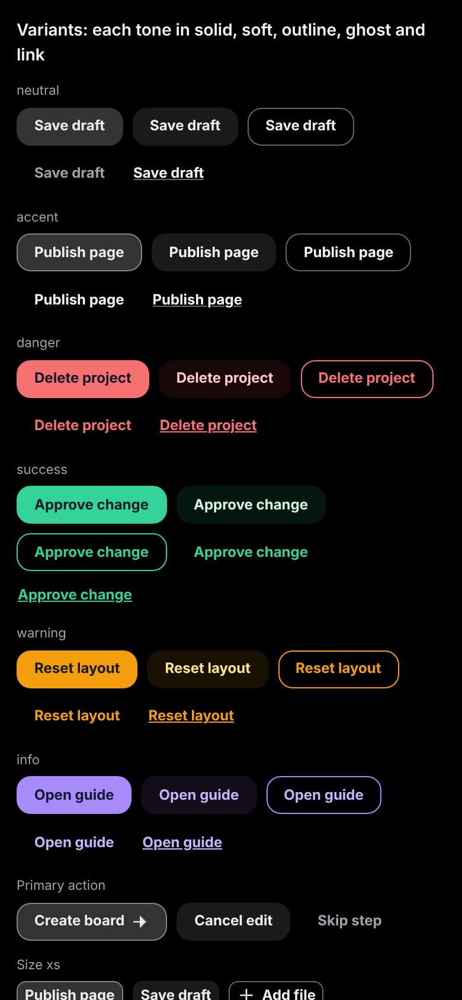
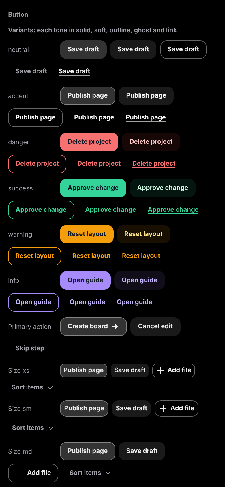
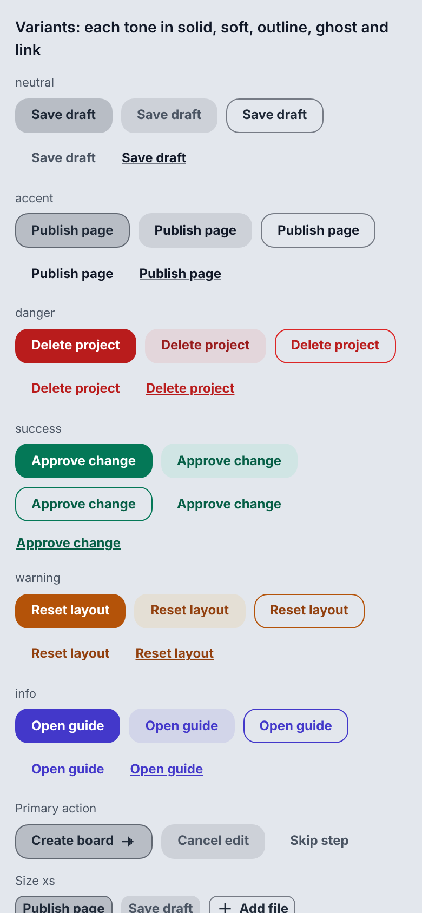
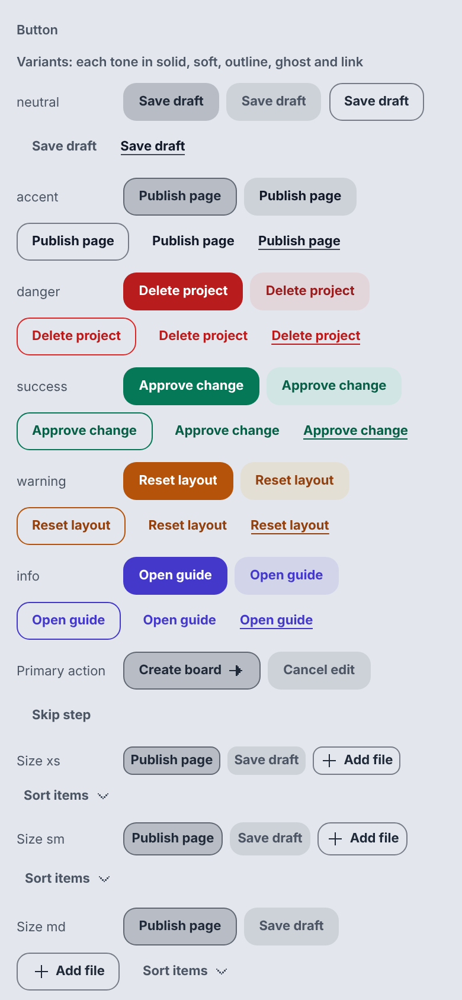
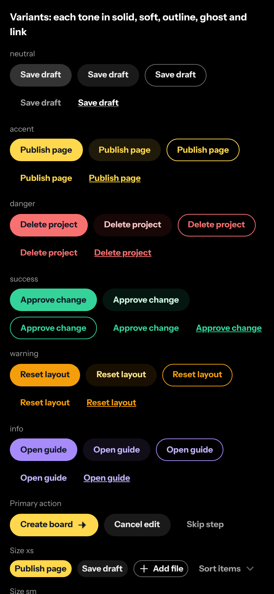
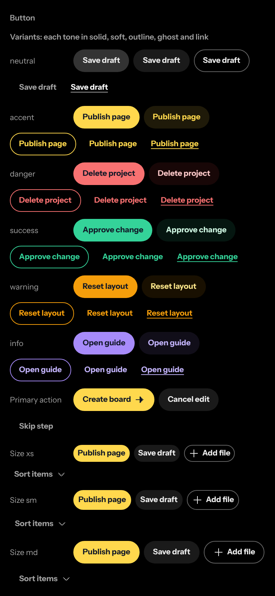
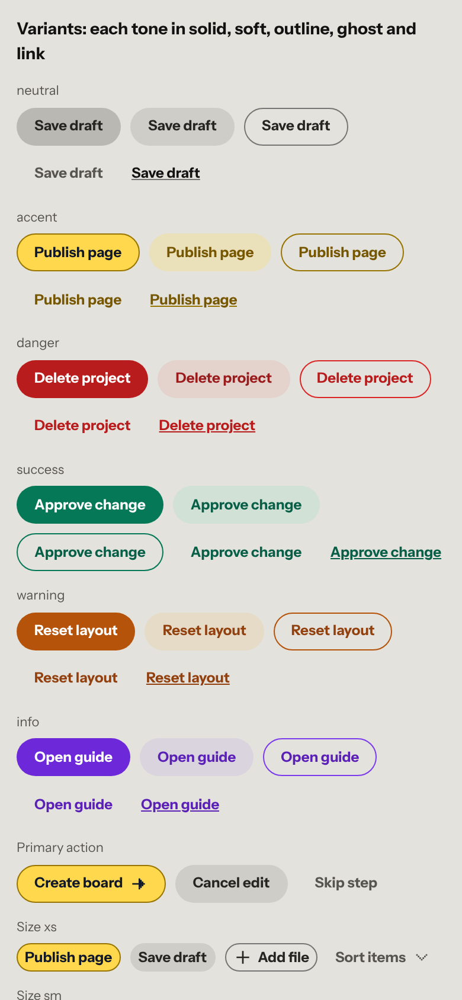
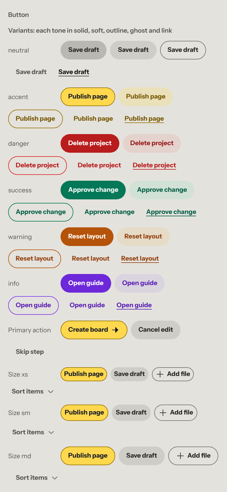
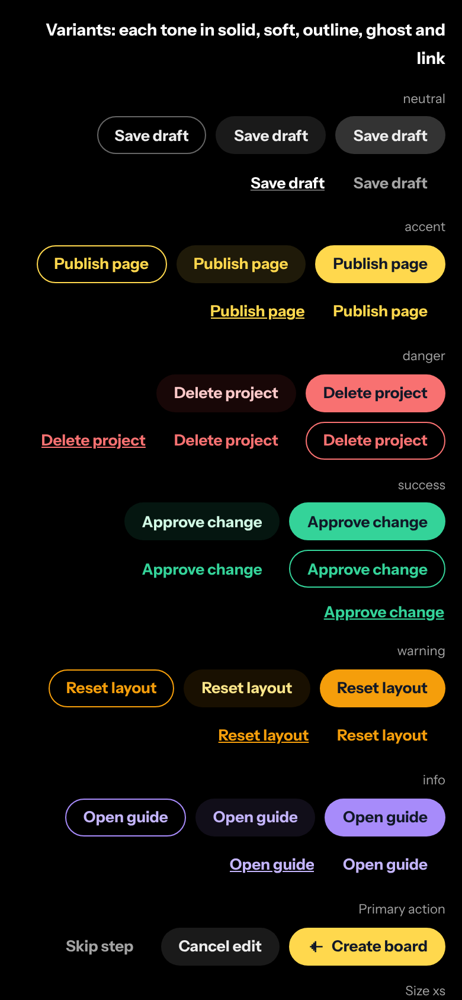
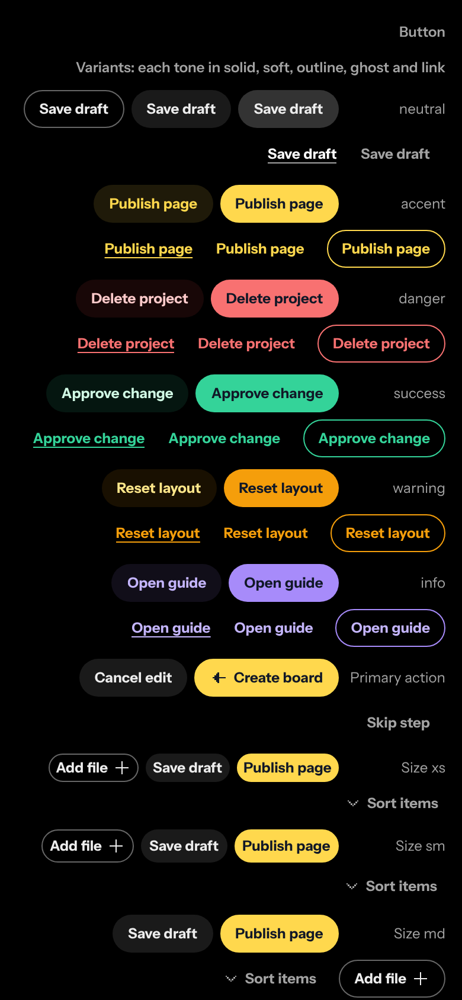

# React Native proof (order 0.16)

The question: does a React Native Button read its look from the same tokens
as the web Button? Yes. Fills, text colors, borders, the control height and
the Desk pill come out of the generated theme objects with the same values the
web Button computes from the CSS variables, in Studio and Desk, dark and
light, and right to left in Arabic. The visible difference between the two is
size: the web clamps fluid tokens down on a 390px phone, while the native
build always takes their max.

## What was built

| Part | Where |
| --- | --- |
| ThemeProvider, `useTheme`, `useOptionalPart`, the resolver, the recipe registry | `packages/native/src/theme/` |
| Button: `Button.tsx`, `ButtonBase.tsx`, `Button.styles.ts`, test, demo | `packages/native/src/components/Button/` |
| IconButton on the Button internals, test coverage in the Button test, demo | `packages/native/src/components/IconButton/` |
| Demo layout with the web case ids | `packages/native/src/demo/` |
| Desk recipe: the default shape is a pill | `packages/styles/desk/native/Button.ts` |
| Expo gallery (SDK 58), axis controls from system Buttons, query string on the web | `apps/gallery-native/` |
| Native icons, now generated into `packages/icons/src/native/` | `packages/icons/templates/native/Icon.tsx.tpl` |
| Manifests: `native` block ready for Button and IconButton | `packages/manifest/src/component/` |

Studio needs no native recipe, so it has no `packages/styles/studio/native/`.

Tests: 60 jest tests on the jest-expo preset with the React Native testing
library, run by `npm run check` (native typecheck and jest, about 35 seconds
cold, 5 warm). They assert the resolved `backgroundColor` and label `color` of
nine tone by emphasis pairs against the token values of studio dark, studio
light, desk dark and desk light, read from the theme objects, so the Desk
light work in progress cannot break them. Also: testIDs, `accessibilityState`,
press, disabled and loading blocking `onPress`, the pressed colors, hitSlop
per platform, right to left, Arabic type, and ThemeProvider resolution and
nesting.

## How the theme objects are consumed

1. `ThemeProvider` resolves the axes in the web order: the prop, the nearest
   parent, then the root default (style `studio`, scheme and density from
   style.json, glass `regular`, lang `en`). At the root the device fills the
   rest: `Platform.OS` for the platform, `I18nManager.isRTL` for the
   direction, `AccessibilityInfo` for reduce motion, reduce transparency and
   more contrast (iOS darker system colors, Android high text contrast), and
   `useColorScheme` for the scheme only when `followSystem` is set.
2. It takes `themes[style][scheme]` from `@the-system/tokens/native`, merges
   `densities[density]` over it, swaps the glass materials for `glass-solid`
   under contrast `more` or reduce transparency, and caches the result per
   combination, so the same axes always give the same object.
3. `useTheme()` returns `{ axes, theme, styleData, reduceMotion,
   reduceTransparency, fonts }`.
4. `createButtonStyles(theme, variants, recipe)` ports Button.css: the CSS
   private properties (`--_button-bg`, `-fg`, `-border-color` and their hover
   and active forms) become fields set in the cascade order of the CSS, the
   sizes take `size.control.*`, `space.*` and `font.size.*`, and the result
   goes through `StyleSheet.create`, memoized per theme object, variant key
   and recipe. A style pack recipe (`(base, theme, variants) => adjustments`)
   is merged over the base before the sheet is created.
5. Conversions from the theme object header: `lineHeight = fontSize *
   leading`; `radius.control` is an em token, scaled from the 16px build base
   to the label size, because CSS resolves `1em` on the button's own font
   size; Arabic takes `font.family.arabic`, `font.leading.arabic.tight`, zero
   letter spacing and small text one step up, as `base.css` does.
6. Touch: `hitSlop` grows the touch area to `size.touch.ios` (44) or
   `size.touch.android` (48) at every size; the web export uses
   `size.target-min` and gets no slop. The height is a minimum, so the button
   grows with the system font size.
7. Press feedback: a Reanimated 4 spring from `spring.press` scales the
   button while pressed, off under reduce motion. Disabled draws with
   `opacity.disabled`. Loading shows an `ActivityIndicator` in the label
   color at `size.icon.sm` over the hidden label, so the width holds.

## Side by side

Each pair is the Button `variants` case at 390 by 844, device scale 2: the
native gallery's web export on the left of the table, the React gallery
(`/c/button?chrome=0&case=variants`) on the right.

| Mode | Native (web export) | React |
| --- | --- | --- |
| Studio dark |  |  |
| Studio light |  |  |
| Desk dark |  |  |
| Desk light |  |  |
| Desk dark, rtl, ar |  |  |

The demo chrome differs on purpose: the web gallery puts row labels in a
column beside the row, the native demo stacks them above it. The buttons are
what to compare.

## Measured values

Computed style of the second button (neutral soft) and the sixth (accent
solid) of the variants case, md size. Web: the React Button in the React
gallery. Native: the React Native Button in the web export. Colors that
match are written once. Desk light was read on the day of the shots; its
values are still being designed (order 0.17).

| Mode | Button | Height web / native | Radius web / native | Fill | Text | Font size web / native | Padding web / native |
| --- | --- | --- | --- | --- | --- | --- | --- |
| studio dark | accent solid | 32 / 32 | 11.01 / 12 | rgba(255, 255, 255, 0.2) | rgb(237, 237, 237) | 11.01 / 12 | 12.02 / 14 |
| studio dark | neutral soft | 32 / 32 | 11.01 / 12 | rgba(255, 255, 255, 0.1) | rgb(237, 237, 237) | 11.01 / 12 | 12.02 / 14 |
| studio light | accent solid | 32 / 32 | 11.01 / 12 | rgba(17, 24, 39, 0.2) | rgb(31, 41, 55) | 11.01 / 12 | 12.02 / 14 |
| studio light | neutral soft | 32 / 32 | 11.01 / 12 | rgba(17, 24, 39, 0.1) | rgb(75, 85, 99) | 11.01 / 12 | 12.02 / 14 |
| desk dark | accent solid | 32 / 32 | 999 / 999 | rgb(255, 216, 77) | rgb(17, 24, 39) | 11.01 / 12 | 12.02 / 14 |
| desk dark | neutral soft | 32 / 32 | 999 / 999 | rgba(255, 255, 255, 0.1) | rgb(237, 237, 237) | 11.01 / 12 | 12.02 / 14 |
| desk light | accent solid | 32 / 32 | 999 / 999 | rgb(255, 216, 77) | rgb(17, 24, 39) | 11.01 / 12 | 12.02 / 14 |
| desk light | neutral soft | 32 / 32 | 999 / 999 | rgba(18, 18, 17, 0.1) | rgb(38, 37, 34) | 11.01 / 12 | 12.02 / 14 |
| desk dark rtl ar | accent solid | 32 / 32 | 999 / 999 | rgb(255, 216, 77) | rgb(17, 24, 39) | 12.01 / 13 | 12.02 / 14 |
| desk dark rtl ar | neutral soft | 32 / 32 | 999 / 999 | rgba(255, 255, 255, 0.1) | rgb(237, 237, 237) | 12.01 / 13 | 12.02 / 14 |

Borders match too: transparent on neutral soft, `color.primary.border` on
accent solid (rgba(255, 255, 255, 0.4) in Studio dark, the yellow in Desk
dark, rgb(152, 116, 0) in Desk light). Font family and weight match: Inter
Variable 700 in Studio, Instrument Sans 700 in Desk, IBM Plex Sans Arabic 700
in Arabic. The native buttons are about 11% wider, all of it from the font
size and padding rows.

## Differences, and where they come from

Fixed in the port during the comparison:

- The button set `alignSelf: 'flex-start'` to act like an inline element. In
  a row that pinned the 24px link buttons to the top while the web centers
  them. The button now leaves its cross axis to the parent, as a web flex row
  does.
- Demo text did not follow the theme direction on the web export
  (react-native-web stamps `dir="auto"` on Text). It now sets
  `writingDirection` from the theme.

From the token contract:

- Fluid tokens. The contract says the native build uses the max of a clamp.
  At 390px the web is near the min: `font.size.s` 11.01 against 12,
  `space.xl` 12.02 against 14, and the em radius follows the font size. On a
  phone the native Button is larger than the web Button at the same width.
- The font stack is cut to its first family. A Latin run inside an Arabic
  label has no fallback in the theme object: a device falls back to the
  system font, the web export to the browser default. The gallery registers
  Instrument Sans under the Arabic family name for Latin code points on the
  web export.
- The style packs ship woff2 files only. iOS and Android cannot register
  them, so on a device text draws in the platform font
  (`ThemeProvider fonts="system"`).

From the platform:

- The link underline sits on the baseline: React Native has no
  `text-underline-offset`, so the web's `space.3xs` offset is lost.
- No hover on touch. Hover colors apply only where React Native reports a
  pointer (`onHoverIn`, the web export, iPad with a pointer).
- No focus ring from tokens: the focus shadow tokens become React Native
  shadow props without a spread, which cannot draw a ring. The platform
  draws keyboard focus.
- The Desk roll label is a hover and keyboard focus effect with no touch
  equivalent. The native Desk recipe has the pill only.

## What the contract could not express on native

1. **Fluid values at phone width.** The theme object carries the max only.
   Either the build also emits the min and the two viewports, so a component
   can interpolate by window width, or the contract says a phone uses the min.
2. **The em base.** Converting `radius.control` at another font size needs the
   build's 16px base. It is not exported; `packages/native/src/theme/units.ts`
   repeats it as `EM_BASE`. The build could export it, or emit
   `radius.control` as a ratio.
3. **Solid materials.** The list of material keys that turn solid under more
   contrast and reduce transparency lives in the token CSS only. The native
   resolver repeats it. The build could emit it as data.
4. **Press scale.** No token holds the press scale; `PRESS_SCALE` (0.97) sits
   in `ButtonBase.tsx` until the motion catalog adds one.
5. **Fonts.** Native needs TTF or OTF files and a fallback family per stack.
6. **Direction for icons.** The native Icon mirrors from `I18nManager.isRTL`
   only. The Button passes a mirror style when the theme direction differs,
   so the web export and a device that has not restarted yet still draw
   directional icons the right way. An icon direction context in the icons
   package would serve every component.
7. **Style pack exports.** `@the-system/styles` exports `./*/native/*`,
   a pattern with two wildcards, which package exports do not allow, so it
   does not resolve. The recipe registry imports the Desk recipe by a
   relative path. A root config fix for the lead: one export per style, or
   `"./native/*"` style paths.
8. **Theme resolution is written twice.** `resolveAxes` repeats the web
   `resolveTheme` because `packages/react` pulls in the DOM. Moving the pure
   part to `packages/shared` would keep the two in step.

## What I learned for wave 2

- Port the CSS cascade literally: a `buttonColors(theme, tone, emphasis)`
  function that sets fields in the CSS order, with the specificity notes
  checked by hand (the accent solid rule beats the general accent rule;
  the link rule comes after the tone rules), made the colors match on the
  first try in every mode.
- Read expected values from the theme object in tests, never copy them.
- A provider has no box on native. Components set `direction` on their own
  root and read `axes.dir`; `I18nManager` is the device default only.
- `react-native-web` renders the native components well enough for pixel
  comparisons, as long as the export registers the same fonts as the web.
- Two React versions in one npm workspace work with exact pins in the native
  workspaces plus a Metro `resolveRequest` and a jest `moduleNameMapper`
  (see `apps/gallery-native/README.md`).
- Reanimated 4 under jest wants its own resolver
  (`react-native-reanimated/jest/resolver`) and `setUpTests()`, not the old
  `mock` module.
- Touch slop overlaps neighbors when the gap is under the slop (sm buttons
  with a 6px gap). React Native gives the press to the top view. A denser
  toolbar on a phone should use `lg` or a wider gap.
