# Recording pack M1: iOS phone surfaces after order M1

Recorded 2026-11-16 20:10 UTC at commit 8c8c5e58 with uncommitted changes, Chromium 153.0.8010.12, load average 6.4 18.1 19.7 on 4 cores (the load does not change the clips: they are drawn on the page's own clock).

Open `index.html` to watch the clips in a grid at real speed. Each clip below has its contact sheet: finger down, mid press or mid drag, finger lifted, settled.

Liquid and Neutral on the ios platform, on the iPhone frame, light and dark. The switch is tapped, then held: from pointerdown the thumb lifts into a raised clear lens larger than the track, and it switches on release. The dialog takes the alert form: a 320 wide card with 32 corners and capsule actions. The sheet has 38 top corners and a round close button at the top leading corner, and is dragged down by its top strip. The tab bar and the alert itself have no clip yet: the clip list has no tab bar press and no AlertDialog open (a request to the lead in docs/reports/lanes/reset-M1.md).

## Switch, Liquid light, iOS (set), an iPhone 15 Pro frame

Taps a switch that is off (finger down 100ms), then presses and holds it for 600ms.

- Clip: [clips/switch-liquid-ios-iphone-light.mp4](clips/switch-liquid-ios-iphone-light.mp4) (2.93s, 176 frames at 60 a second, 73 KB)
- The screen first changes 17ms after the finger lands, while it is still down.
- Source: none. No compare pair covers this style and interaction.

## Switch, Liquid dark, iOS (set), an iPhone 15 Pro frame

Taps a switch that is off (finger down 100ms), then presses and holds it for 600ms.

- Clip: [clips/switch-liquid-ios-iphone-dark.mp4](clips/switch-liquid-ios-iphone-dark.mp4) (2.93s, 176 frames at 60 a second, 74 KB)
- The screen first changes 17ms after the finger lands, while it is still down.
- Source: none. No compare pair covers this style and interaction.

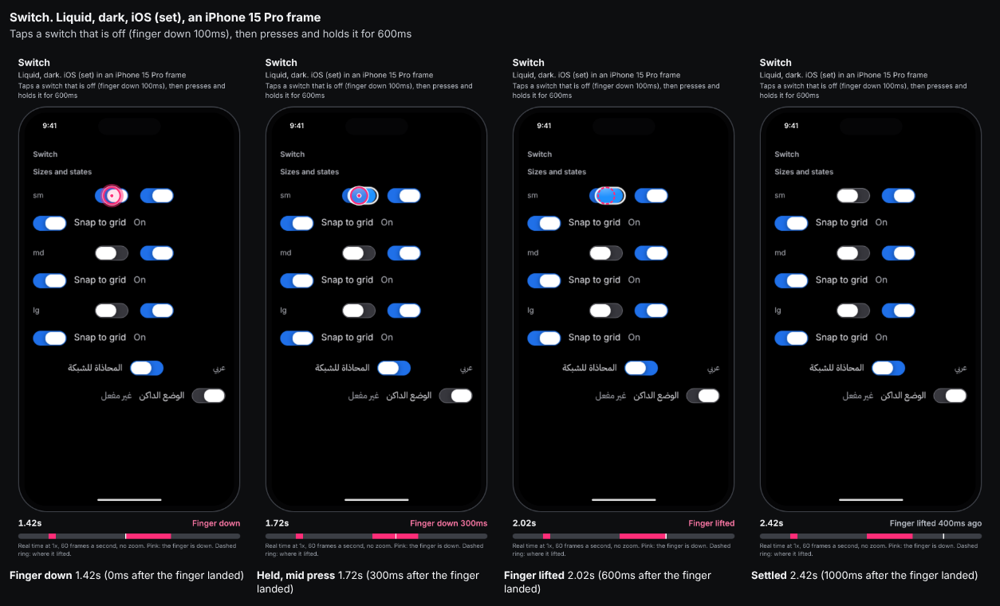

## Switch, Neutral light, iOS (set), an iPhone 15 Pro frame

Taps a switch that is off (finger down 100ms), then presses and holds it for 600ms.

- Clip: [clips/switch-neutral-ios-iphone-light.mp4](clips/switch-neutral-ios-iphone-light.mp4) (2.93s, 176 frames at 60 a second, 74 KB)
- The screen first changes 17ms after the finger lands, while it is still down.
- Source: none. No compare pair covers this style and interaction.

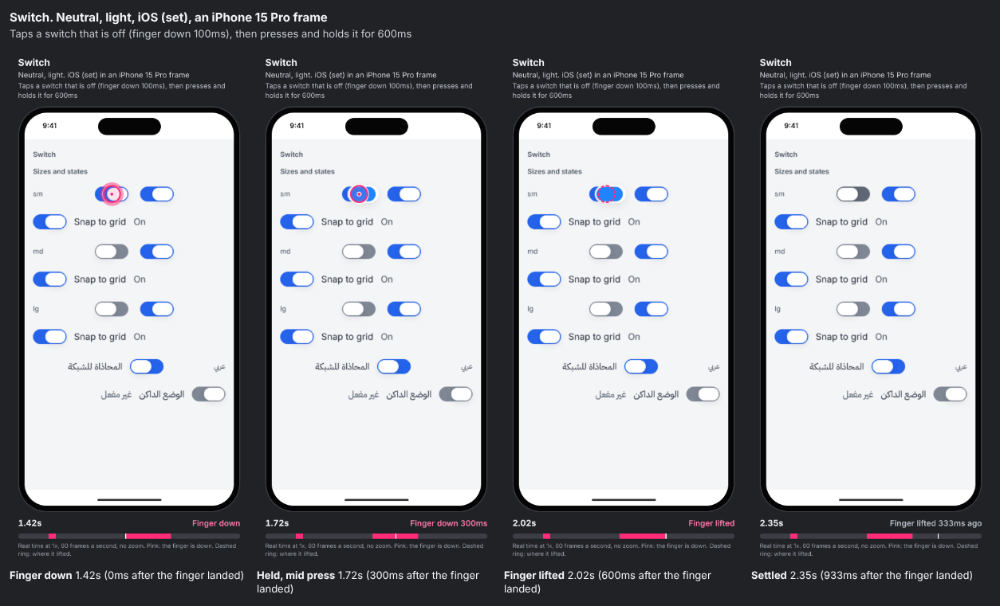

## Switch, Neutral dark, iOS (set), an iPhone 15 Pro frame

Taps a switch that is off (finger down 100ms), then presses and holds it for 600ms.

- Clip: [clips/switch-neutral-ios-iphone-dark.mp4](clips/switch-neutral-ios-iphone-dark.mp4) (2.93s, 176 frames at 60 a second, 75 KB)
- The screen first changes 17ms after the finger lands, while it is still down.
- Source: none. No compare pair covers this style and interaction.

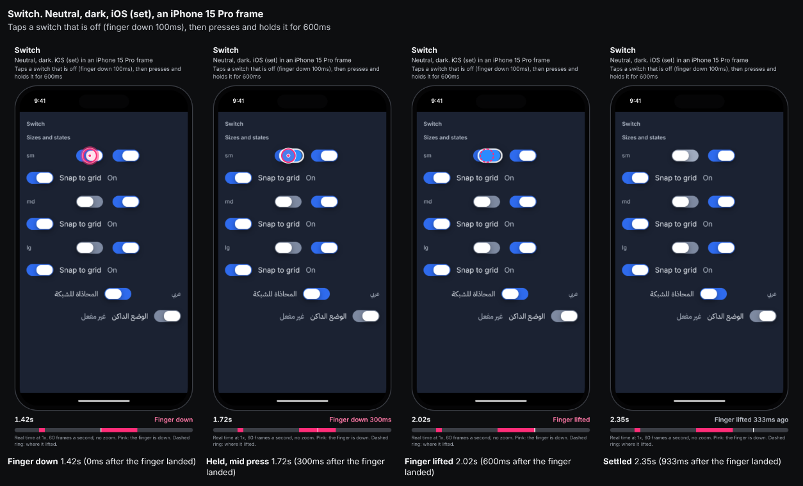

## Dialog open, Liquid light, iOS (set), an iPhone 15 Pro frame

Taps the button that opens a dialog (finger down 100ms).

- Clip: [clips/dialog-open-liquid-ios-iphone-light.mp4](clips/dialog-open-liquid-ios-iphone-light.mp4) (1.72s, 103 frames at 60 a second, 112 KB)
- The screen first changes 17ms after the finger lands, while it is still down.
- Source: none. No compare pair covers this style and interaction.

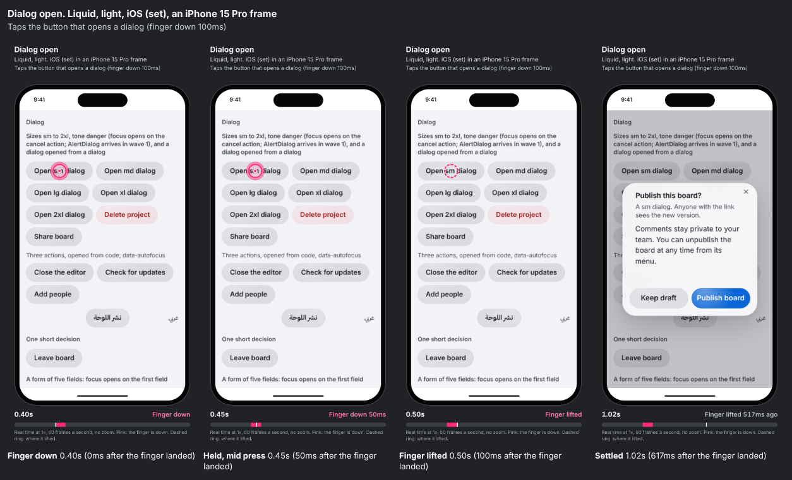

## Dialog open, Liquid dark, iOS (set), an iPhone 15 Pro frame

Taps the button that opens a dialog (finger down 100ms).

- Clip: [clips/dialog-open-liquid-ios-iphone-dark.mp4](clips/dialog-open-liquid-ios-iphone-dark.mp4) (1.72s, 103 frames at 60 a second, 112 KB)
- The screen first changes 33ms after the finger lands, while it is still down.
- Source: none. No compare pair covers this style and interaction.

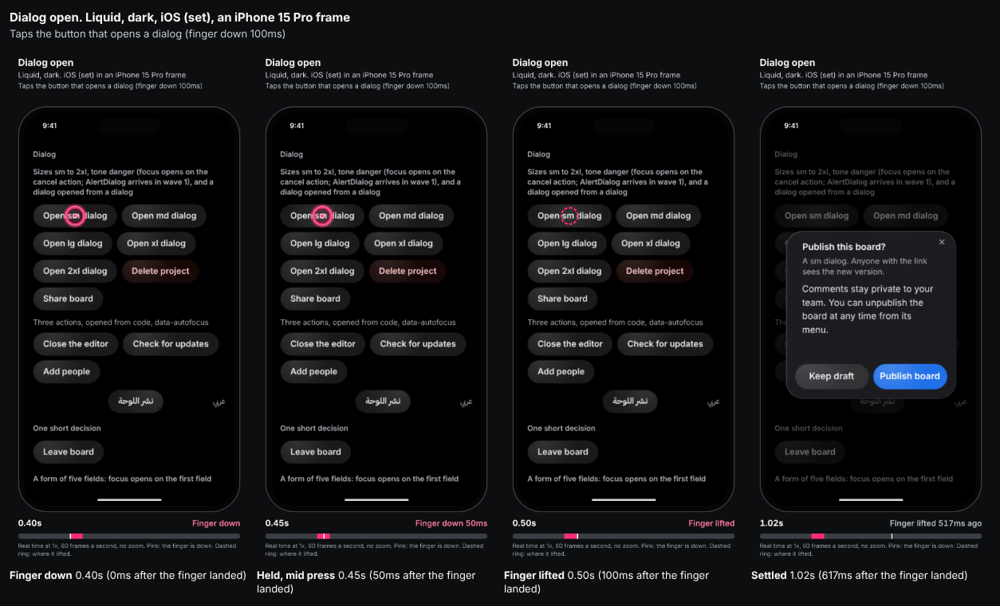

## Dialog open, Neutral light, iOS (set), an iPhone 15 Pro frame

Taps the button that opens a dialog (finger down 100ms).

- Clip: [clips/dialog-open-neutral-ios-iphone-light.mp4](clips/dialog-open-neutral-ios-iphone-light.mp4) (1.72s, 103 frames at 60 a second, 109 KB)
- The screen first changes 133ms after the finger lands, after it lifted.
- Source: none. No compare pair covers this style and interaction.

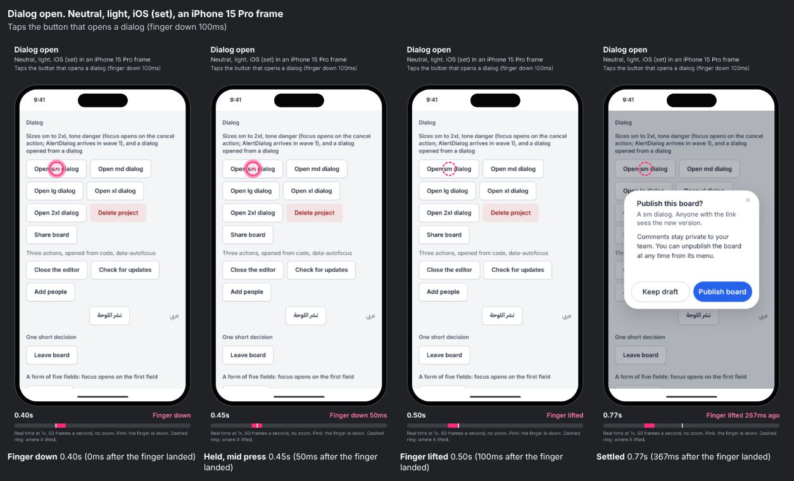

## Dialog open, Neutral dark, iOS (set), an iPhone 15 Pro frame

Taps the button that opens a dialog (finger down 100ms).

- Clip: [clips/dialog-open-neutral-ios-iphone-dark.mp4](clips/dialog-open-neutral-ios-iphone-dark.mp4) (1.72s, 103 frames at 60 a second, 94 KB)
- The screen first changes 133ms after the finger lands, after it lifted.
- Source: none. No compare pair covers this style and interaction.

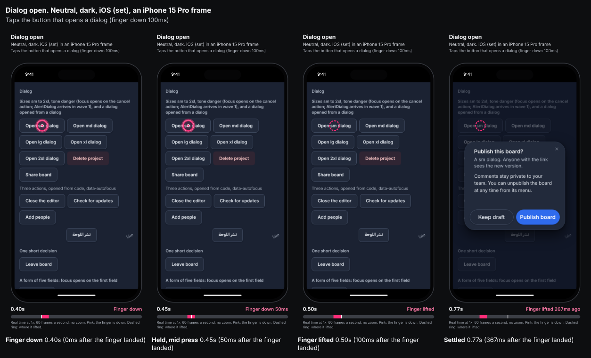

## Sheet drag, Liquid light, iOS (set), an iPhone 15 Pro frame

With the sheet open, puts a finger on its handle, drags it down 260px over 300ms and lets go.

- Clip: [clips/sheet-drag-liquid-ios-iphone-light.mp4](clips/sheet-drag-liquid-ios-iphone-light.mp4) (2.02s, 121 frames at 60 a second, 88 KB)
- The screen first changes 117ms after the finger lands, while it is still down.
- Source: none. No compare pair covers this style and interaction.

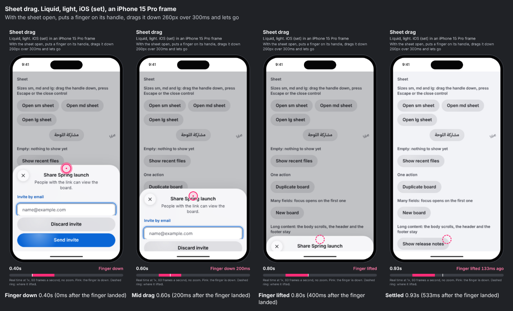

## Sheet drag, Liquid dark, iOS (set), an iPhone 15 Pro frame

With the sheet open, puts a finger on its handle, drags it down 260px over 300ms and lets go.

- Clip: [clips/sheet-drag-liquid-ios-iphone-dark.mp4](clips/sheet-drag-liquid-ios-iphone-dark.mp4) (2.02s, 121 frames at 60 a second, 101 KB)
- The screen first changes 117ms after the finger lands, while it is still down.
- Source: none. No compare pair covers this style and interaction.

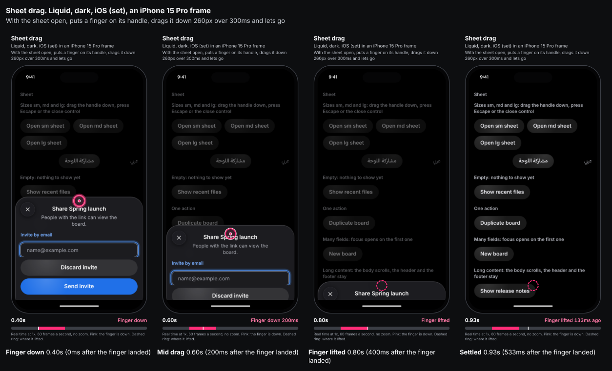

## Sheet drag, Neutral light, iOS (set), an iPhone 15 Pro frame

With the sheet open, puts a finger on its handle, drags it down 260px over 300ms and lets go.

- Clip: [clips/sheet-drag-neutral-ios-iphone-light.mp4](clips/sheet-drag-neutral-ios-iphone-light.mp4) (2.02s, 121 frames at 60 a second, 92 KB)
- The screen first changes 117ms after the finger lands, while it is still down.
- Source: none. No compare pair covers this style and interaction.

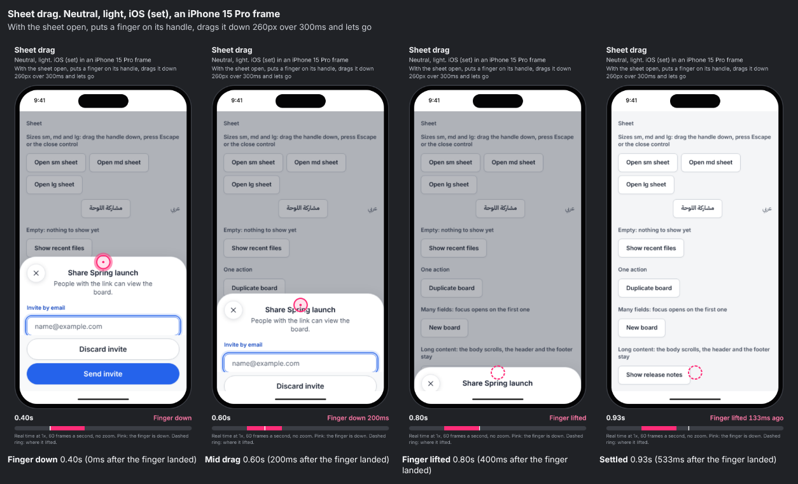

## Sheet drag, Neutral dark, iOS (set), an iPhone 15 Pro frame

With the sheet open, puts a finger on its handle, drags it down 260px over 300ms and lets go.

- Clip: [clips/sheet-drag-neutral-ios-iphone-dark.mp4](clips/sheet-drag-neutral-ios-iphone-dark.mp4) (2.02s, 121 frames at 60 a second, 95 KB)
- The screen first changes 117ms after the finger lands, while it is still down.
- Source: none. No compare pair covers this style and interaction.

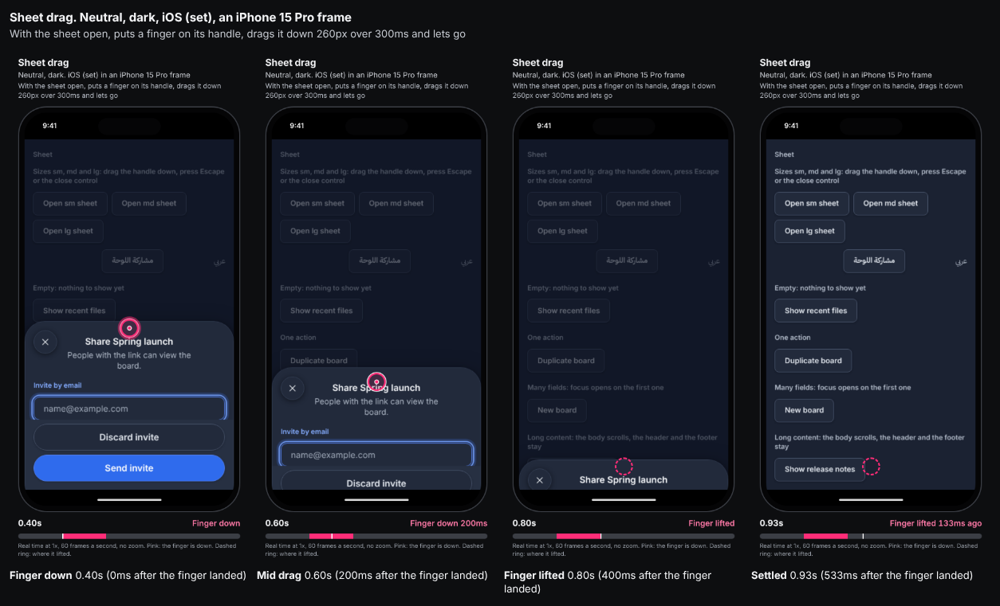

