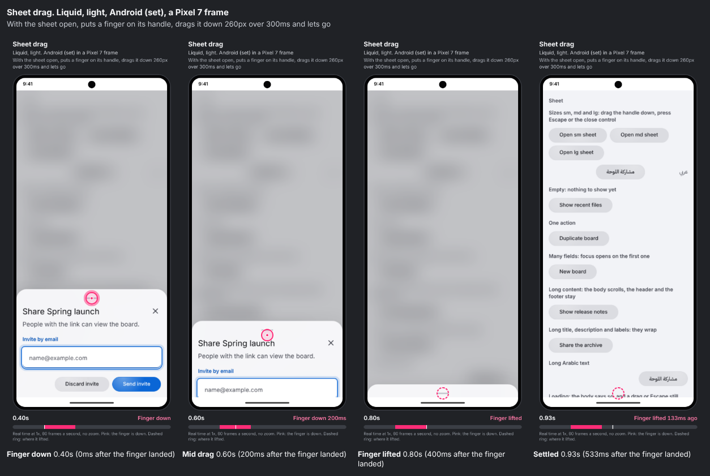
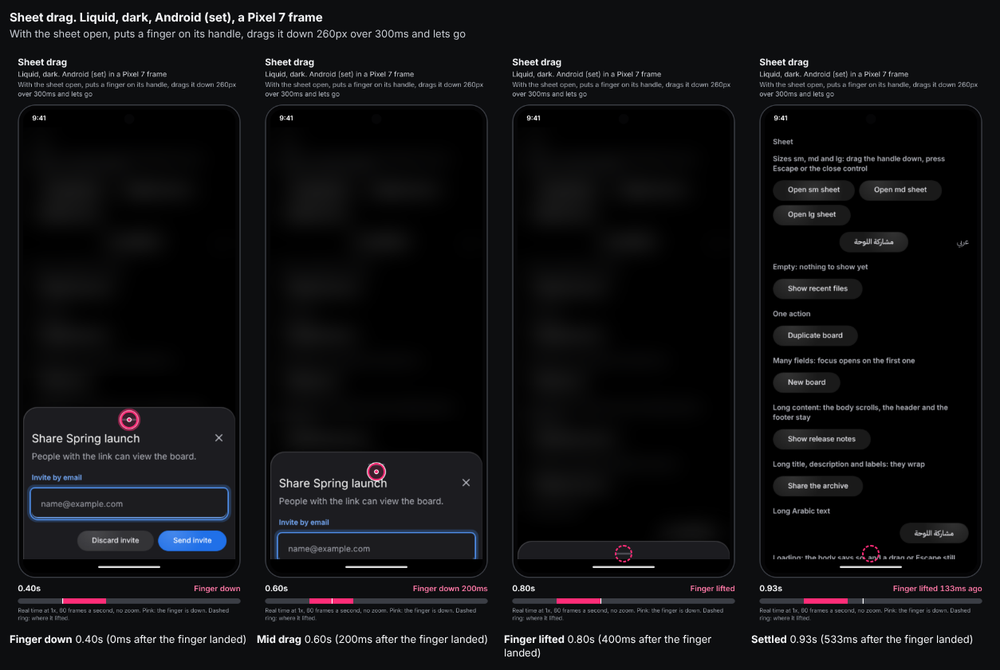

# Recording pack M2: Android phone surfaces after order M2

Recorded 2026-11-16 20:04 UTC at commit 8c8c5e58 with uncommitted changes, Chromium 153.0.8010.12, load average 5.4 16.9 19.3 on 4 cores (the load does not change the clips: they are drawn on the page's own clock).

Open `index.html` to watch the clips in a grid at real speed. Each clip below has its contact sheet: finger down, mid press or mid drag, finger lifted, settled.

Neutral and Liquid on the android platform, on the Pixel frame, light and dark. The switch is tapped, then held: from pointerdown the 40 state layer shows round the thumb and the 16 dot grows to 28. The button shows the ripple. The dialog grows in place with 28 corners and text actions at the end. The sheet has 28 top corners and a 32 by 4 handle and is dragged down. The navigation bar has no clip yet: the clip list has no tab bar press (a request to the lead in docs/reports/lanes/reset-M2.md).

## Sheet drag, Liquid light, Android (set), a Pixel 7 frame

With the sheet open, puts a finger on its handle, drags it down 260px over 300ms and lets go.

- Clip: [clips/sheet-drag-liquid-android-pixel-light.mp4](clips/sheet-drag-liquid-android-pixel-light.mp4) (2.02s, 121 frames at 60 a second, 113 KB)
- The screen first changes 117ms after the finger lands, while it is still down.
- Source: none. No compare pair covers this style and interaction.

## Sheet drag, Liquid dark, Android (set), a Pixel 7 frame

With the sheet open, puts a finger on its handle, drags it down 260px over 300ms and lets go.

- Clip: [clips/sheet-drag-liquid-android-pixel-dark.mp4](clips/sheet-drag-liquid-android-pixel-dark.mp4) (2.02s, 121 frames at 60 a second, 111 KB)
- The screen first changes 117ms after the finger lands, while it is still down.
- Source: none. No compare pair covers this style and interaction.

