# Recording pack M2: Android phone surfaces after order M2

Recorded 2026-11-16 20:18 UTC at commit 0d0675f7 with uncommitted changes, Chromium 153.0.8010.12, load average 8.5 14.2 17.5 on 4 cores (the load does not change the clips: they are drawn on the page's own clock).

Open `index.html` to watch the clips in a grid at real speed. Each clip below has its contact sheet: finger down, mid press or mid drag, finger lifted, settled.

Neutral and Liquid on the android platform, on the Pixel frame, light and dark. The switch is tapped, then held: from pointerdown the 40 state layer shows round the thumb and the 16 dot grows to 28. The button shows the ripple. The dialog grows in place with 28 corners and text actions at the end. The sheet has 28 top corners and a 32 by 4 handle and is dragged down. The navigation bar has no clip yet: the clip list has no tab bar press (a request to the lead in docs/reports/lanes/reset-M2.md).

## Switch, Neutral light, Android (set), a Pixel 7 frame

Taps a switch that is off (finger down 100ms), then presses and holds it for 600ms.

- Clip: [clips/switch-neutral-android-pixel-light.mp4](clips/switch-neutral-android-pixel-light.mp4) (2.93s, 176 frames at 60 a second, 71 KB)
- The screen first changes 17ms after the finger lands, while it is still down.
- Source: none. No compare pair covers this style and interaction.

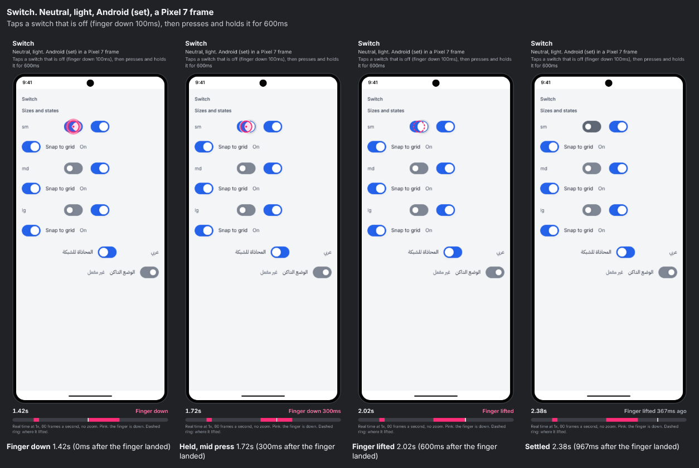

## Switch, Neutral dark, Android (set), a Pixel 7 frame

Taps a switch that is off (finger down 100ms), then presses and holds it for 600ms.

- Clip: [clips/switch-neutral-android-pixel-dark.mp4](clips/switch-neutral-android-pixel-dark.mp4) (2.93s, 176 frames at 60 a second, 72 KB)
- The screen first changes 17ms after the finger lands, while it is still down.
- Source: none. No compare pair covers this style and interaction.

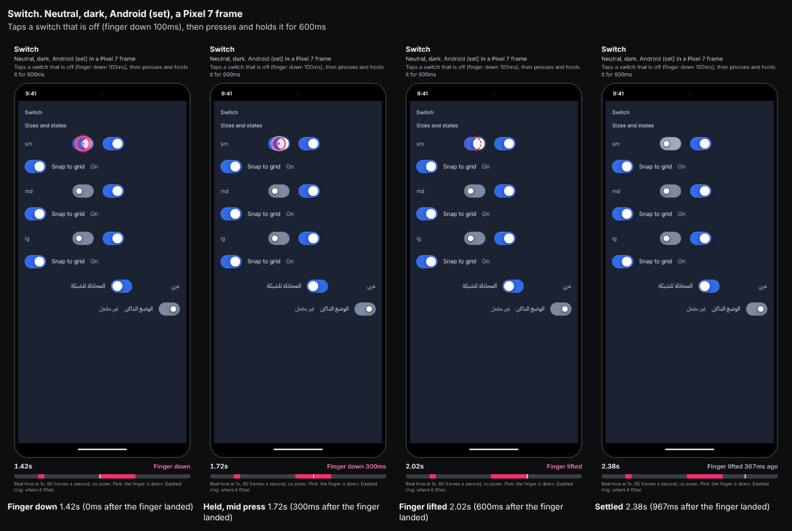

## Switch, Liquid light, Android (set), a Pixel 7 frame

Taps a switch that is off (finger down 100ms), then presses and holds it for 600ms.

- Clip: [clips/switch-liquid-android-pixel-light.mp4](clips/switch-liquid-android-pixel-light.mp4) (3.03s, 182 frames at 60 a second, 74 KB)
- The screen first changes 17ms after the finger lands, while it is still down.
- Source: none. No compare pair covers this style and interaction.

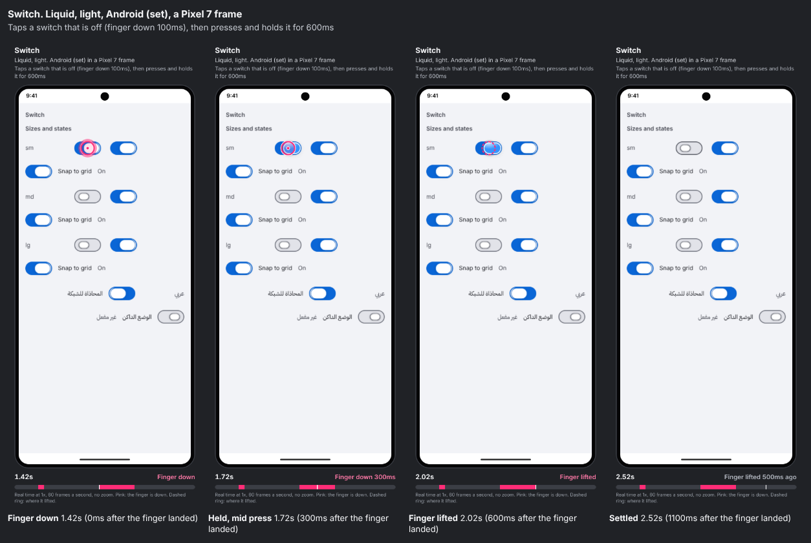

## Switch, Liquid dark, Android (set), a Pixel 7 frame

Taps a switch that is off (finger down 100ms), then presses and holds it for 600ms.

- Clip: [clips/switch-liquid-android-pixel-dark.mp4](clips/switch-liquid-android-pixel-dark.mp4) (3.03s, 182 frames at 60 a second, 75 KB)
- The screen first changes 17ms after the finger lands, while it is still down.
- Source: none. No compare pair covers this style and interaction.

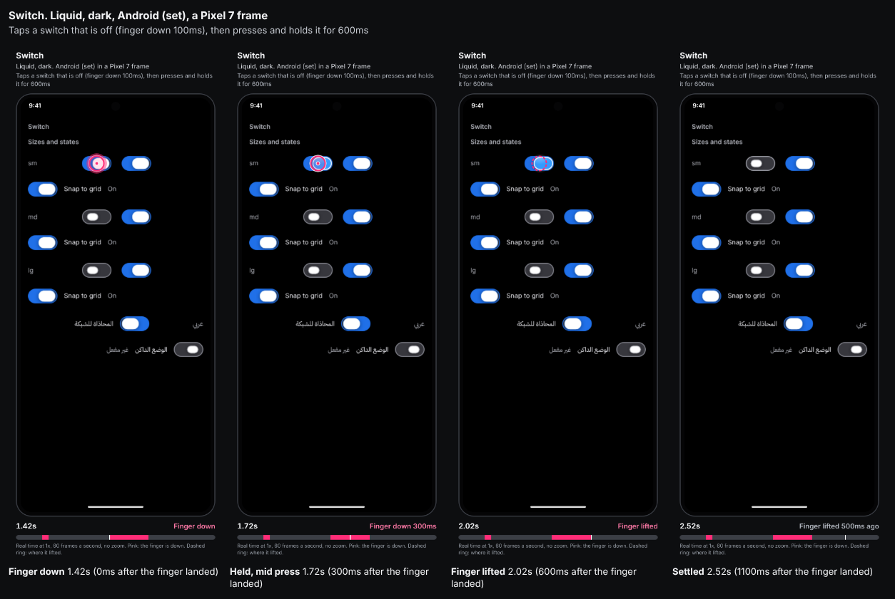

## Button press, Neutral light, Android (set), a Pixel 7 frame

Taps the button (finger down 100ms), then presses and holds it for 600ms.

- Clip: [clips/button-press-neutral-android-pixel-light.mp4](clips/button-press-neutral-android-pixel-light.mp4) (2.93s, 176 frames at 60 a second, 89 KB)
- The screen first changes 117ms after the finger lands, after it lifted.
- Source: none. No compare pair covers this style and interaction.

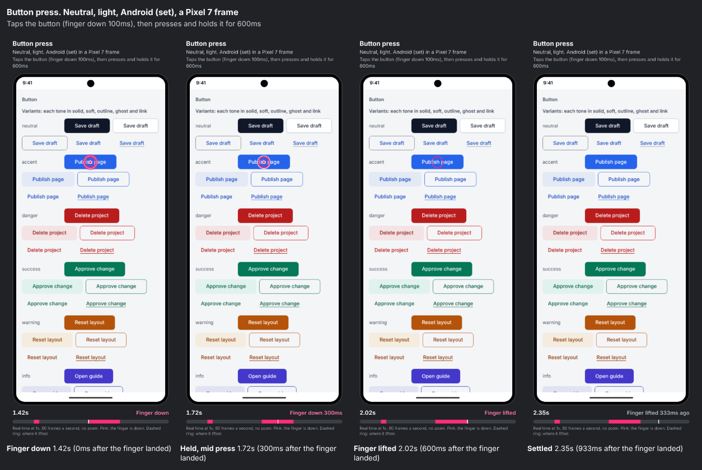

## Button press, Neutral dark, Android (set), a Pixel 7 frame

Taps the button (finger down 100ms), then presses and holds it for 600ms.

- Clip: [clips/button-press-neutral-android-pixel-dark.mp4](clips/button-press-neutral-android-pixel-dark.mp4) (2.93s, 176 frames at 60 a second, 88 KB)
- The screen first changes 117ms after the finger lands, after it lifted.
- Source: none. No compare pair covers this style and interaction.

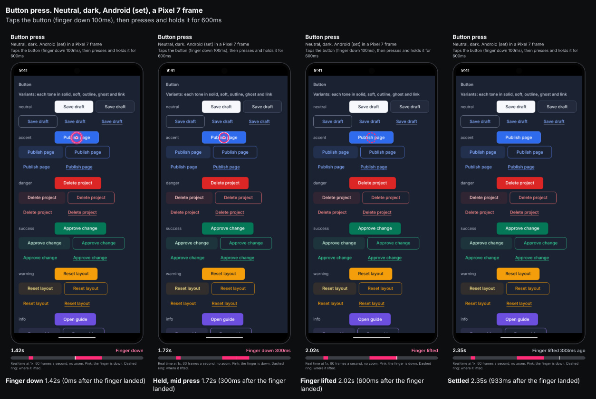

## Button press, Liquid light, Android (set), a Pixel 7 frame

Taps the button (finger down 100ms), then presses and holds it for 600ms.

- Clip: [clips/button-press-liquid-android-pixel-light.mp4](clips/button-press-liquid-android-pixel-light.mp4) (3.08s, 185 frames at 60 a second, 95 KB)
- The screen first changes 17ms after the finger lands, while it is still down.
- Source: none. No compare pair covers this style and interaction.

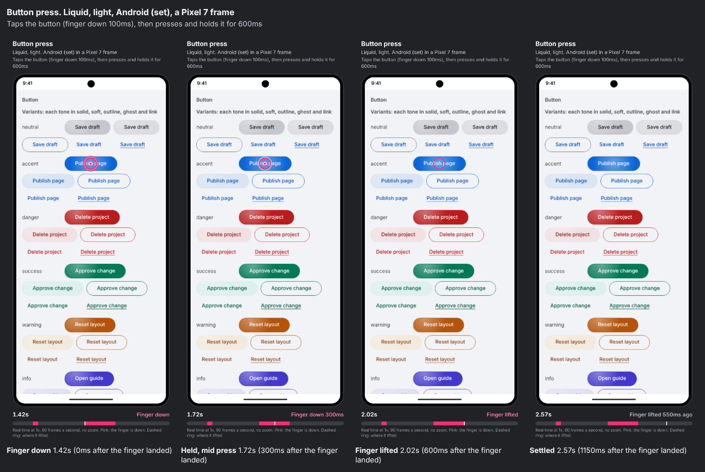

## Button press, Liquid dark, Android (set), a Pixel 7 frame

Taps the button (finger down 100ms), then presses and holds it for 600ms.

- Clip: [clips/button-press-liquid-android-pixel-dark.mp4](clips/button-press-liquid-android-pixel-dark.mp4) (3.08s, 185 frames at 60 a second, 94 KB)
- The screen first changes 17ms after the finger lands, while it is still down.
- Source: none. No compare pair covers this style and interaction.

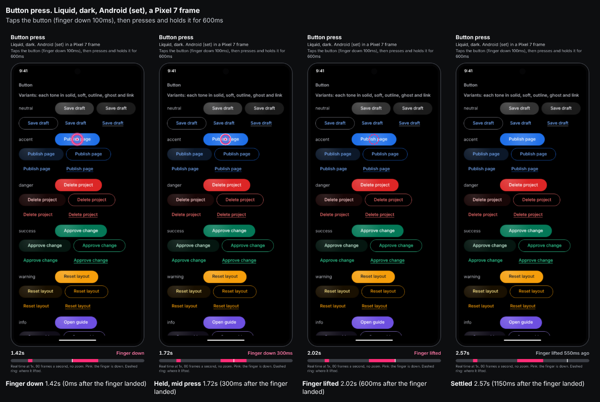

## Dialog open, Neutral light, Android (set), a Pixel 7 frame

Taps the button that opens a dialog (finger down 100ms).

- Clip: [clips/dialog-open-neutral-android-pixel-light.mp4](clips/dialog-open-neutral-android-pixel-light.mp4) (1.72s, 103 frames at 60 a second, 99 KB)
- The screen first changes 133ms after the finger lands, after it lifted.
- Source: none. No compare pair covers this style and interaction.

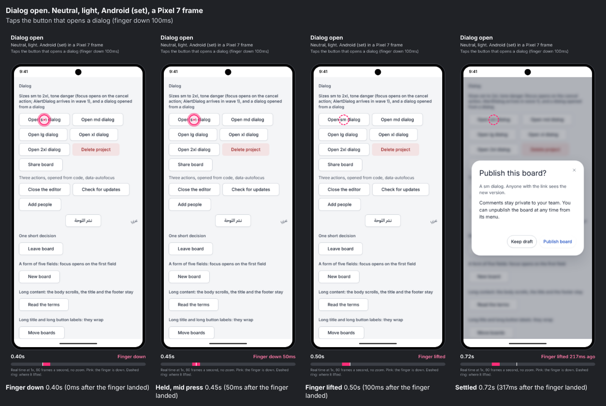

## Dialog open, Neutral dark, Android (set), a Pixel 7 frame

Taps the button that opens a dialog (finger down 100ms).

- Clip: [clips/dialog-open-neutral-android-pixel-dark.mp4](clips/dialog-open-neutral-android-pixel-dark.mp4) (1.72s, 103 frames at 60 a second, 94 KB)
- The screen first changes 133ms after the finger lands, after it lifted.
- Source: none. No compare pair covers this style and interaction.

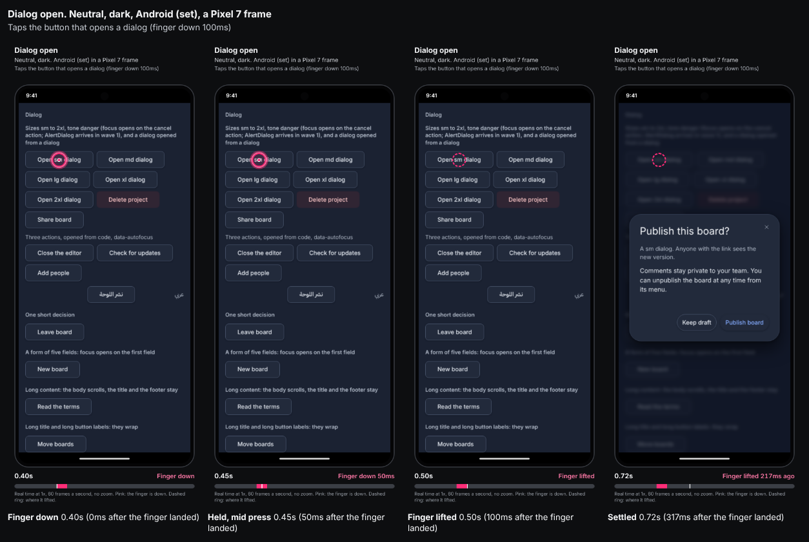

## Dialog open, Liquid light, Android (set), a Pixel 7 frame

Taps the button that opens a dialog (finger down 100ms).

- Clip: [clips/dialog-open-liquid-android-pixel-light.mp4](clips/dialog-open-liquid-android-pixel-light.mp4) (1.72s, 103 frames at 60 a second, 107 KB)
- The screen first changes 17ms after the finger lands, while it is still down.
- Source: none. No compare pair covers this style and interaction.

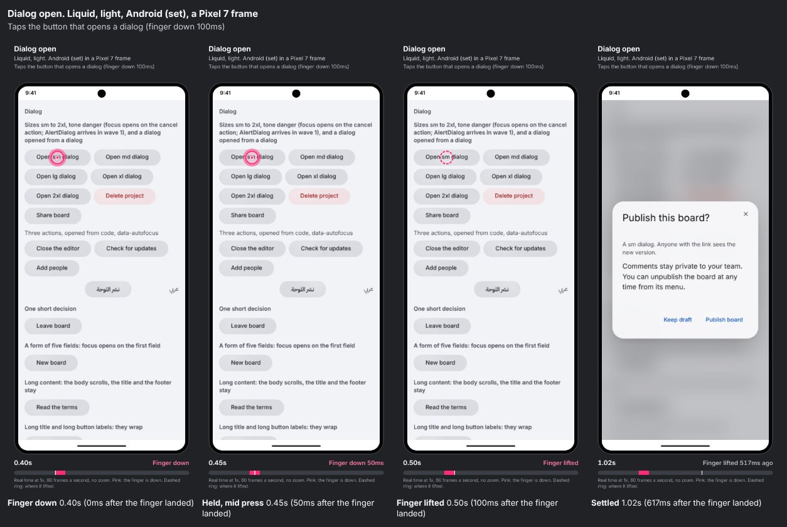

## Dialog open, Liquid dark, Android (set), a Pixel 7 frame

Taps the button that opens a dialog (finger down 100ms).

- Clip: [clips/dialog-open-liquid-android-pixel-dark.mp4](clips/dialog-open-liquid-android-pixel-dark.mp4) (1.72s, 103 frames at 60 a second, 102 KB)
- The screen first changes 17ms after the finger lands, while it is still down.
- Source: none. No compare pair covers this style and interaction.

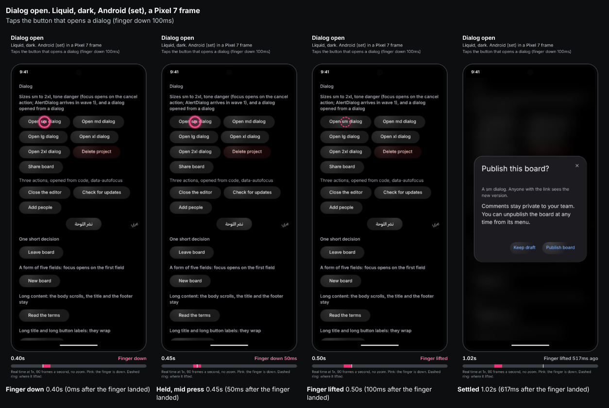

## Sheet drag, Neutral light, Android (set), a Pixel 7 frame

With the sheet open, puts a finger on its handle, drags it down 260px over 300ms and lets go.

- Clip: [clips/sheet-drag-neutral-android-pixel-light.mp4](clips/sheet-drag-neutral-android-pixel-light.mp4) (2.02s, 121 frames at 60 a second, 116 KB)
- The screen first changes 117ms after the finger lands, while it is still down.
- Source: none. No compare pair covers this style and interaction.

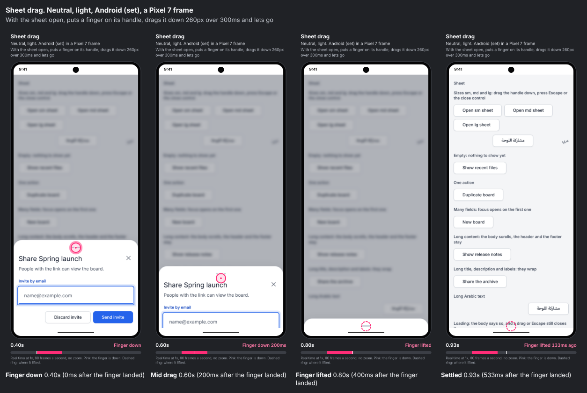

## Sheet drag, Neutral dark, Android (set), a Pixel 7 frame

With the sheet open, puts a finger on its handle, drags it down 260px over 300ms and lets go.

- Clip: [clips/sheet-drag-neutral-android-pixel-dark.mp4](clips/sheet-drag-neutral-android-pixel-dark.mp4) (2.02s, 121 frames at 60 a second, 109 KB)
- The screen first changes 117ms after the finger lands, while it is still down.
- Source: none. No compare pair covers this style and interaction.

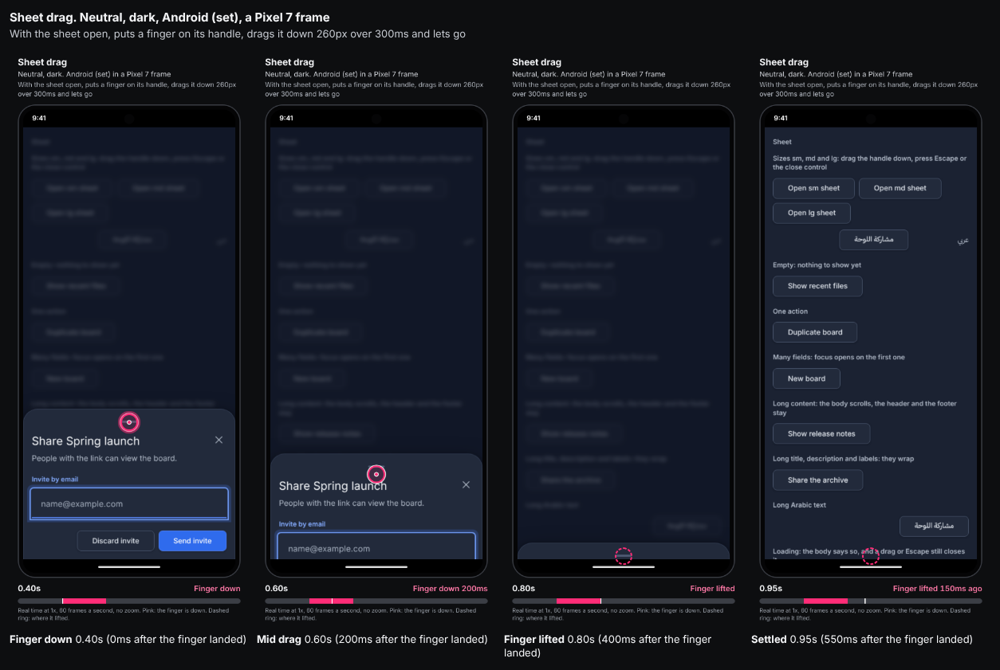

## Sheet drag, Liquid light, Android (set), a Pixel 7 frame

With the sheet open, puts a finger on its handle, drags it down 260px over 300ms and lets go.

- Clip: [clips/sheet-drag-liquid-android-pixel-light.mp4](clips/sheet-drag-liquid-android-pixel-light.mp4) (2.02s, 121 frames at 60 a second, 124 KB)
- The screen first changes 117ms after the finger lands, while it is still down.
- Source: none. No compare pair covers this style and interaction.

## Sheet drag, Liquid dark, Android (set), a Pixel 7 frame

With the sheet open, puts a finger on its handle, drags it down 260px over 300ms and lets go.

- Clip: [clips/sheet-drag-liquid-android-pixel-dark.mp4](clips/sheet-drag-liquid-android-pixel-dark.mp4) (2.02s, 121 frames at 60 a second, 111 KB)
- The screen first changes 117ms after the finger lands, while it is still down.
- Source: none. No compare pair covers this style and interaction.

