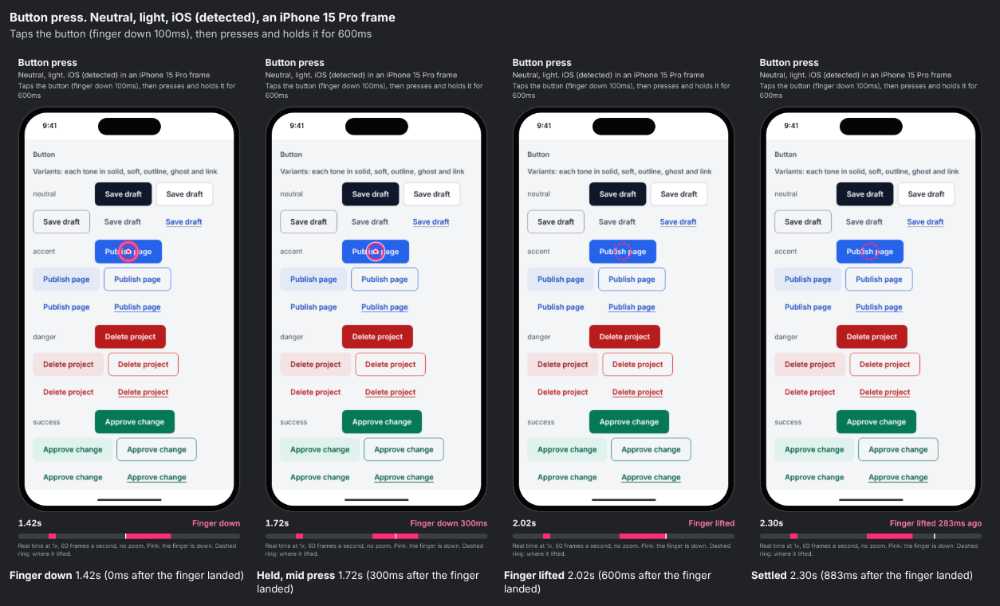
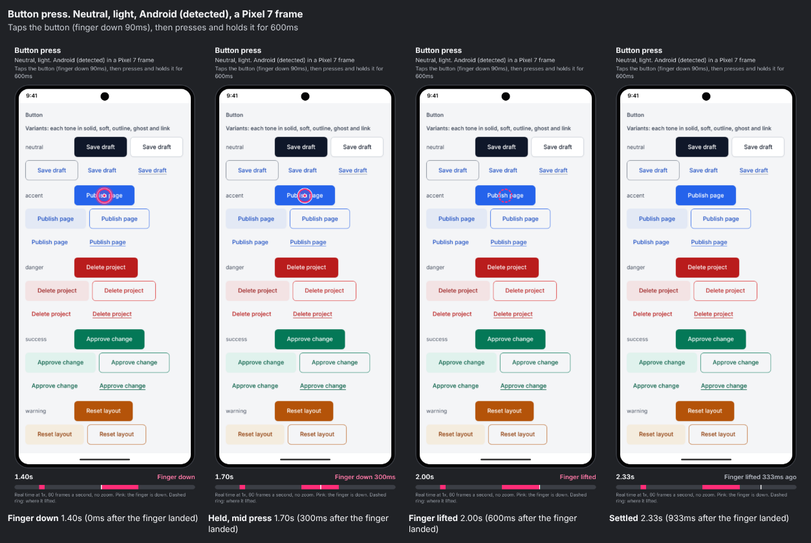
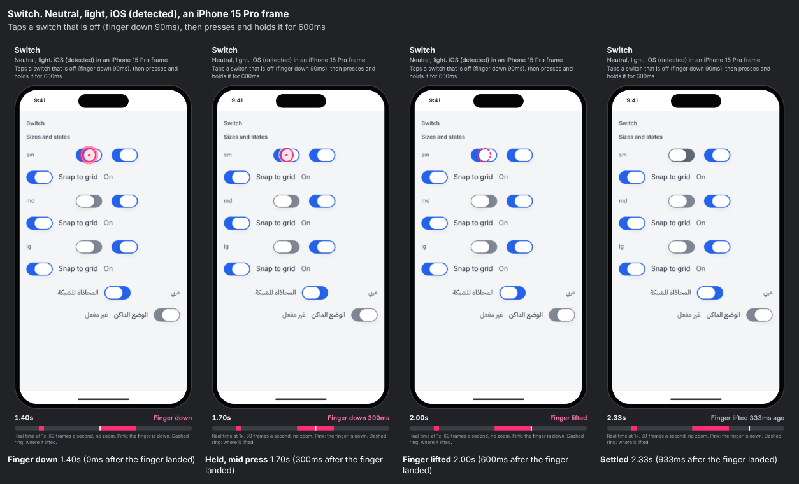
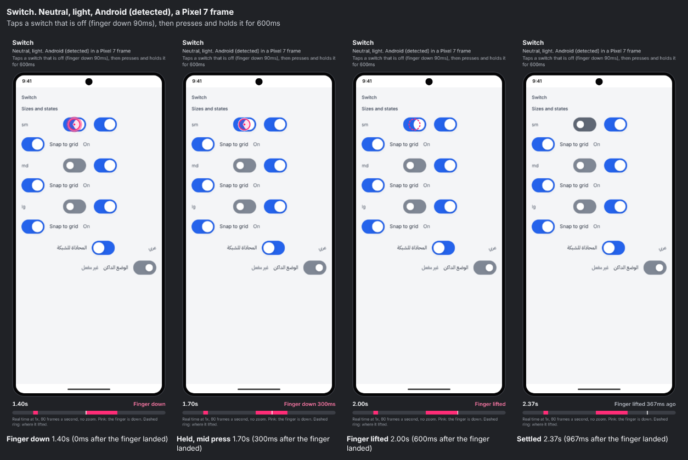
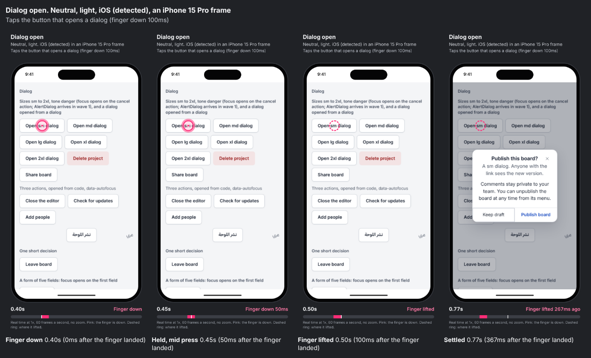
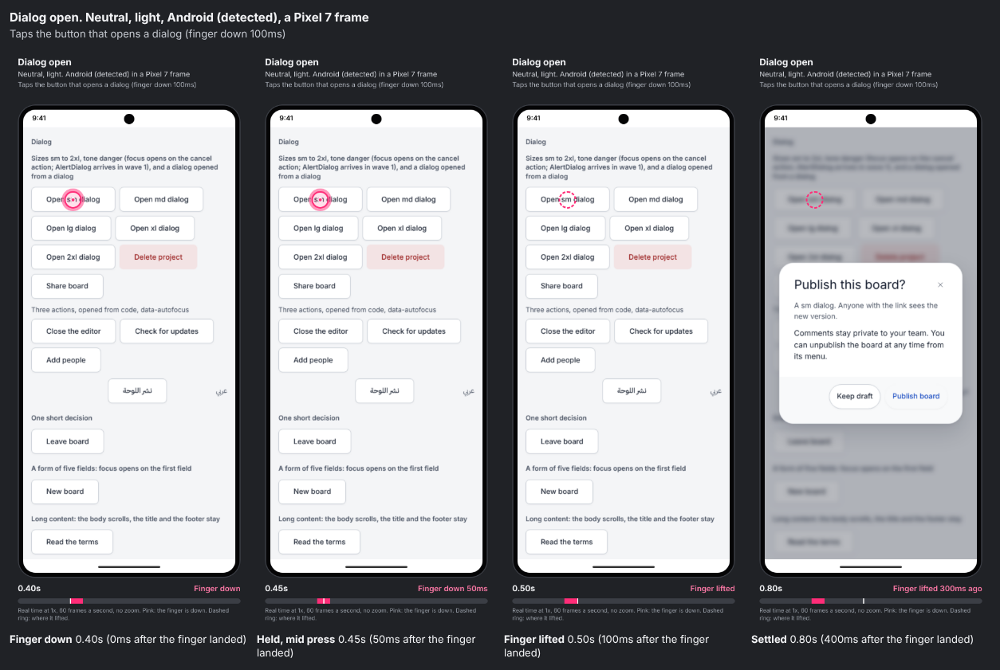
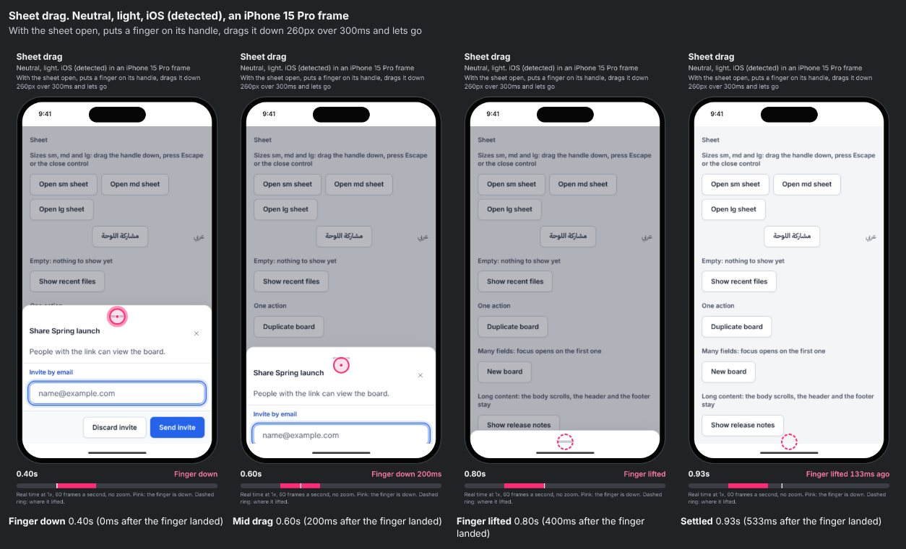
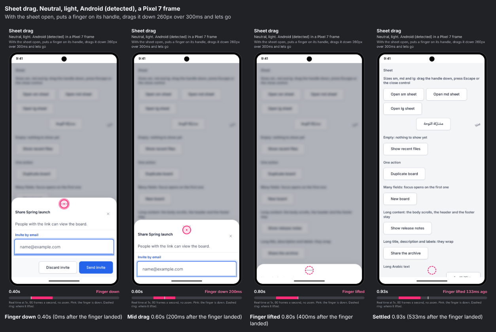
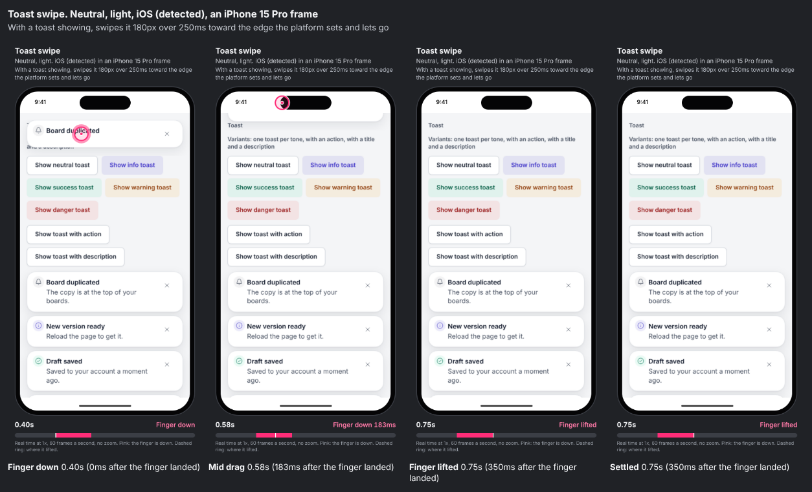
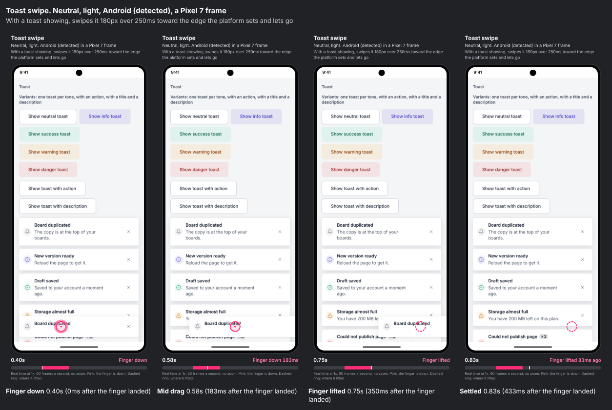

# Recording pack R0.9: Sample pack for the owner to approve the format

Recorded 2026-11-16 15:13 UTC at commit b722b65c with uncommitted changes, Chromium 153.0.8010.12, load average 5.8 5.8 11.0 on 4 cores (the load does not change the clips: they are drawn on the page's own clock).

Open `index.html` to watch the clips in a grid at real speed. Each clip below has its contact sheet: finger down, mid press or mid drag, finger lifted, settled.

Neutral, light, platform auto (the page detects iOS on the iPhone frame and Android on the Pixel frame). Neutral has no source screen, so no source clip sits beside these; the index shows one wherever a clip names a compare pair. Dark is one flag away (--scheme light,dark) and was left out of the sample to keep it small.

## Button press, Neutral light, iOS (detected), an iPhone 15 Pro frame

Taps the button (finger down 100ms), then presses and holds it for 600ms.

- Clip: [clips/button-press-neutral-auto-iphone-light.mp4](clips/button-press-neutral-auto-iphone-light.mp4) (2.93s, 176 frames at 60 a second, 85 KB)
- The screen first changes 117ms after the finger lands, after it lifted.
- Source: none. No compare pair covers this style and interaction.

## Button press, Neutral light, Android (detected), a Pixel 7 frame

Taps the button (finger down 100ms), then presses and holds it for 600ms.

- Clip: [clips/button-press-neutral-auto-pixel-light.mp4](clips/button-press-neutral-auto-pixel-light.mp4) (2.93s, 176 frames at 60 a second, 87 KB)
- The screen first changes 117ms after the finger lands, after it lifted.
- Source: none. No compare pair covers this style and interaction.

## Switch, Neutral light, iOS (detected), an iPhone 15 Pro frame

Taps a switch that is off (finger down 100ms), then presses and holds it for 600ms.

- Clip: [clips/switch-neutral-auto-iphone-light.mp4](clips/switch-neutral-auto-iphone-light.mp4) (2.93s, 176 frames at 60 a second, 72 KB)
- The screen first changes 117ms after the finger lands, after it lifted.
- Source: none. No compare pair covers this style and interaction.

## Switch, Neutral light, Android (detected), a Pixel 7 frame

Taps a switch that is off (finger down 100ms), then presses and holds it for 600ms.

- Clip: [clips/switch-neutral-auto-pixel-light.mp4](clips/switch-neutral-auto-pixel-light.mp4) (2.93s, 176 frames at 60 a second, 73 KB)
- The screen first changes 117ms after the finger lands, after it lifted.
- Source: none. No compare pair covers this style and interaction.

## Dialog open, Neutral light, iOS (detected), an iPhone 15 Pro frame

Taps the button that opens a dialog (finger down 100ms).

- Clip: [clips/dialog-open-neutral-auto-iphone-light.mp4](clips/dialog-open-neutral-auto-iphone-light.mp4) (1.72s, 103 frames at 60 a second, 105 KB)
- The screen first changes 133ms after the finger lands, after it lifted.
- Source: none. No compare pair covers this style and interaction.

## Dialog open, Neutral light, Android (detected), a Pixel 7 frame

Taps the button that opens a dialog (finger down 100ms).

- Clip: [clips/dialog-open-neutral-auto-pixel-light.mp4](clips/dialog-open-neutral-auto-pixel-light.mp4) (1.72s, 103 frames at 60 a second, 100 KB)
- The screen first changes 133ms after the finger lands, after it lifted.
- Source: none. No compare pair covers this style and interaction.

## Sheet drag, Neutral light, iOS (detected), an iPhone 15 Pro frame

With the sheet open, puts a finger on its handle, drags it down 260px over 300ms and lets go.

- Clip: [clips/sheet-drag-neutral-auto-iphone-light.mp4](clips/sheet-drag-neutral-auto-iphone-light.mp4) (2.02s, 121 frames at 60 a second, 83 KB)
- The screen first changes 117ms after the finger lands, while it is still down.
- Source: none. No compare pair covers this style and interaction.

## Sheet drag, Neutral light, Android (detected), a Pixel 7 frame

With the sheet open, puts a finger on its handle, drags it down 260px over 300ms and lets go.

- Clip: [clips/sheet-drag-neutral-auto-pixel-light.mp4](clips/sheet-drag-neutral-auto-pixel-light.mp4) (2.02s, 121 frames at 60 a second, 111 KB)
- The screen first changes 117ms after the finger lands, while it is still down.
- Source: none. No compare pair covers this style and interaction.

## Toast swipe, Neutral light, iOS (detected), an iPhone 15 Pro frame

With a toast showing, swipes it 180px over 250ms toward the edge the platform sets and lets go.

- Clip: [clips/toast-swipe-neutral-auto-iphone-light.mp4](clips/toast-swipe-neutral-auto-iphone-light.mp4) (1.77s, 106 frames at 60 a second, 63 KB)
- The screen first changes 33ms after the finger lands, while it is still down.
- Source: none. No compare pair covers this style and interaction.

## Toast swipe, Neutral light, Android (detected), a Pixel 7 frame

With a toast showing, swipes it 180px over 250ms toward the edge the platform sets and lets go.

- Clip: [clips/toast-swipe-neutral-auto-pixel-light.mp4](clips/toast-swipe-neutral-auto-pixel-light.mp4) (1.77s, 106 frames at 60 a second, 68 KB)
- The screen first changes 117ms after the finger lands, while it is still down.
- Source: none. No compare pair covers this style and interaction.

