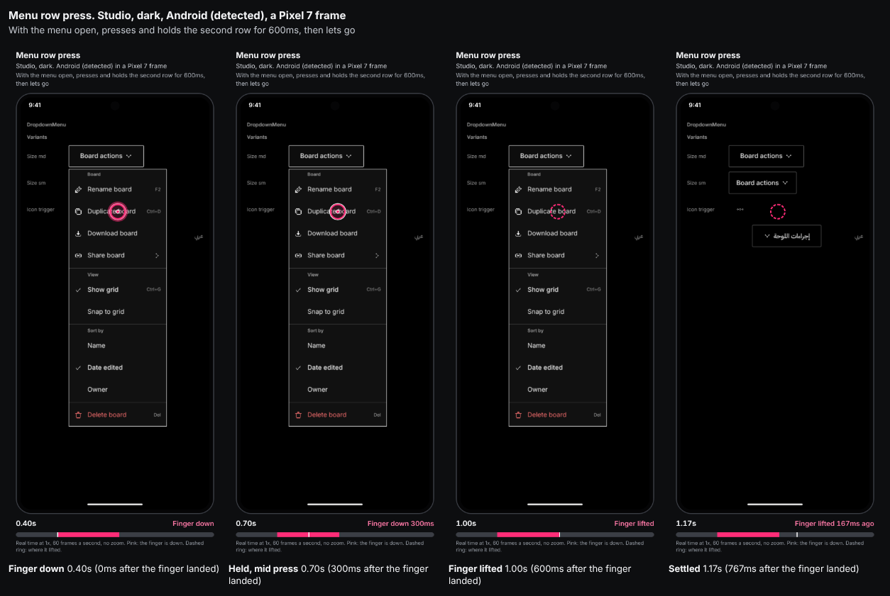

# Recording pack R0.9: Sample pack for the owner to approve the format

Recorded 2026-11-16 15:14 UTC at commit b722b65c with uncommitted changes, Chromium 153.0.8010.12, load average 14.2 11.2 11.6 on 4 cores (the load does not change the clips: they are drawn on the page's own clock).

Open `index.html` to watch the clips in a grid at real speed. Each clip below has its contact sheet: finger down, mid press or mid drag, finger lifted, settled.

A run of pack R0.9 changed for this folder: clips menu-row-press; styles studio; devices pixel; schemes dark. It is evidence for the order, not part of its sample pack.

## Menu row press, Studio dark, Android (detected), a Pixel 7 frame

With the menu open, presses and holds the second row for 600ms, then lets go.

- Clip: [clips/menu-row-press-studio-auto-pixel-dark.mp4](clips/menu-row-press-studio-auto-pixel-dark.mp4) (1.92s, 115 frames at 60 a second, 60 KB)
- The screen first changes 617ms after the finger lands, after it lifted.
- Source: [clips/menu-row-press-studio-auto-pixel-dark.source.mp4](clips/menu-row-press-studio-auto-pixel-dark.source.mp4). In FK2 a right click on a layer or a row action opens ContextMenu (src/ui/components/ContextMenu). The harness renders that component with FK2's globals.css, opened at a point, with five rows and a separator. A reconstruction from source parts.

