# Styles apart: Studio, Desk and Neutral (order 1.24)

Status: all three looks are **proposed**, waiting on the owner (HUMAN GATE).
Branch `claude/ds-order-1-24`. `npm run check` green at every commit.

The owner, after testing the live gallery on a phone: "Studio and Desk really
look so close, it can't be like that by any means", and "toast and popups need
enhancement in all systems". The before sheets show why: Desk had been built as
"Studio dark plus desk values", so a Select list, an alert dialog and a toast
were the same dark gray rounded box in both, and the two dialog buttons were
the same gray pill.

This order pushes every dial of PLAN.md 3.7 apart and redraws every overlay
surface in each style. Only tokens, recipes, motion presets and `style.json`
changed: no markup, no behavior, no component CSS.

## The three looks in one line each

- **Studio**: flat, hard, compact and monochrome. No shadow and no blur
  anywhere, a white primary pill (black in light), transparent bordered pills,
  square overlays with a hairline, inverted lit rows, hard cuts in steps.
- **Desk**: glass objects on a grained black desk. Light edge and deep
  shadow on every surface, yellow `#ffd84d` primary, filled glass pills, 1rem
  windows, roomy, Instrument Sans with tight tracking, windows grow on a
  spring.
- **Neutral**: the light first product UI. White cards with a 1px border and
  a soft shadow, one blue primary, 8px controls (not pills), outline
  secondary, 150 to 200ms ease out.

## Sheets

Each sheet shows Studio, Desk and Neutral side by side, 1280px on top and
390px below, one per component and scheme.

- Before: `shots/styles-apart/before/<component>-<scheme>.png`
- After: `shots/styles-apart/after/<component>-<scheme>.png`

Components covered: button, input, checkbox, switch, tabs, card, sidebar,
select (open), dialog, alert-dialog, sheet, drawer, dropdown-menu,
context-menu, menubar, popover, tooltip, hover-card, toast (four shown,
stacked), combobox (open), command-palette (open). Menubar and context-menu
have no before sheet: the capture script missed them in the first run, and
the fix came after the changes.

| Component | Before (dark) | After (dark) | After (light) |
| --- | --- | --- | --- |
| AlertDialog | 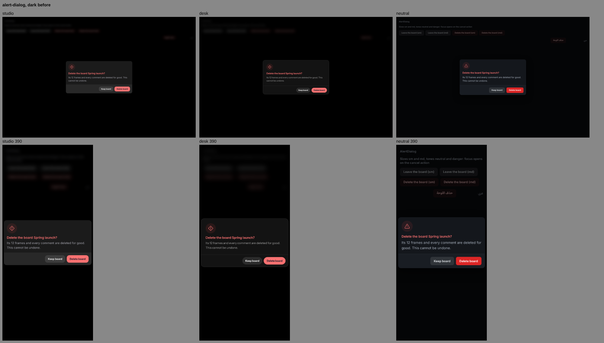 | 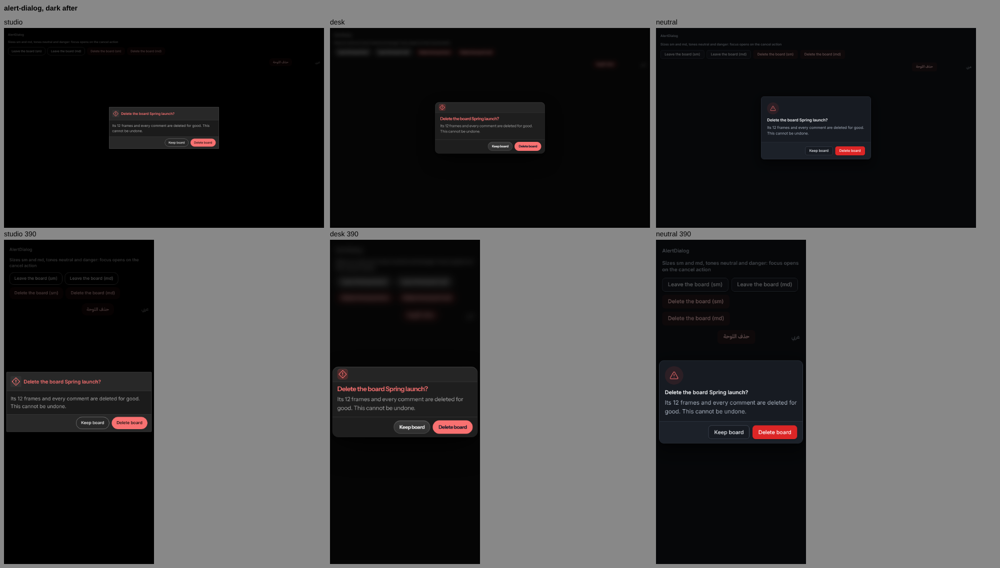 | 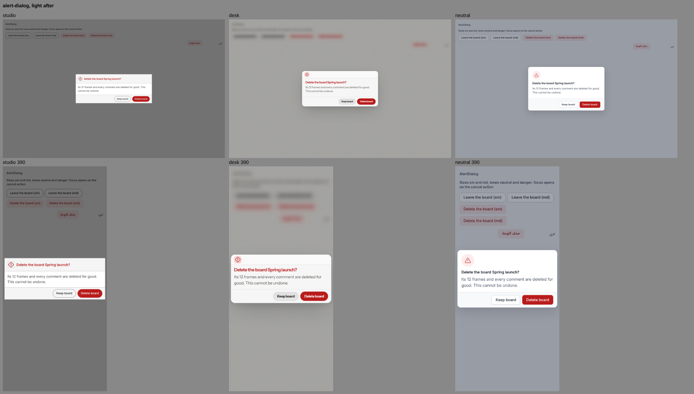 |
| Dialog | 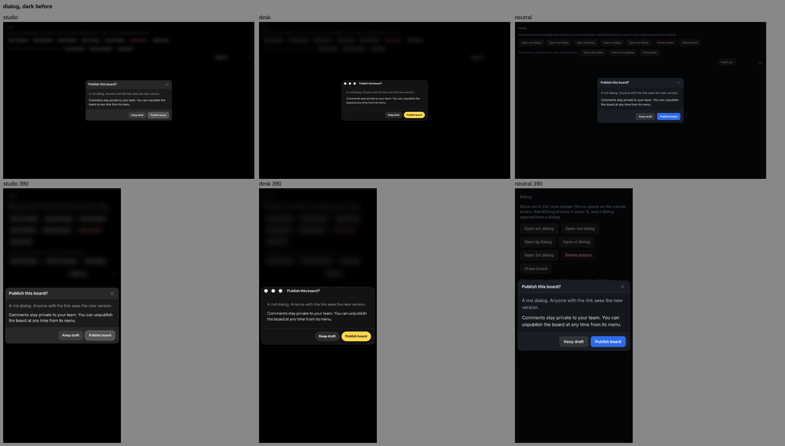 | 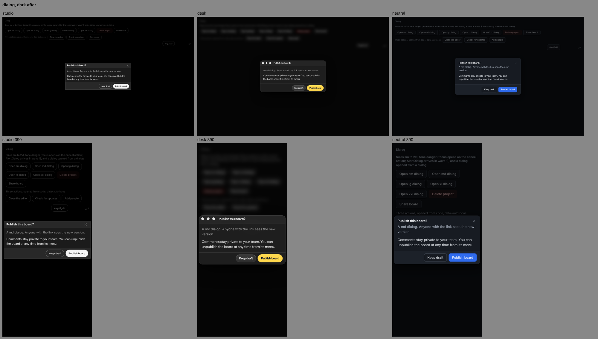 | 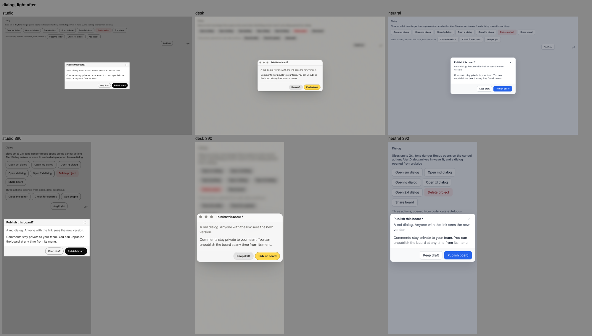 |
| Toast | 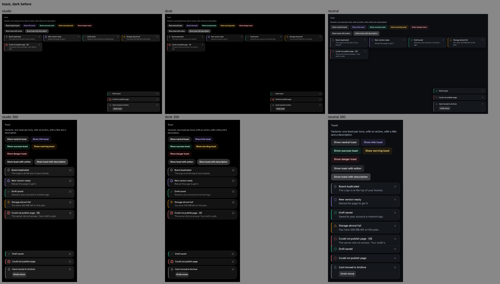 | 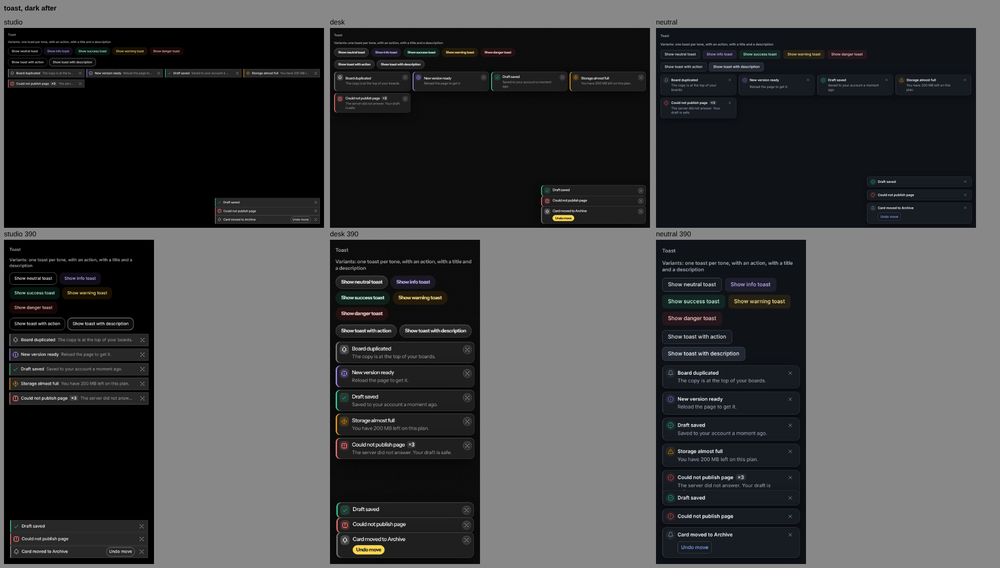 | 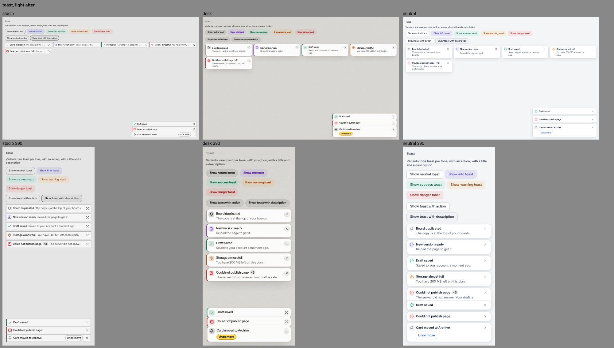 |
| Select | 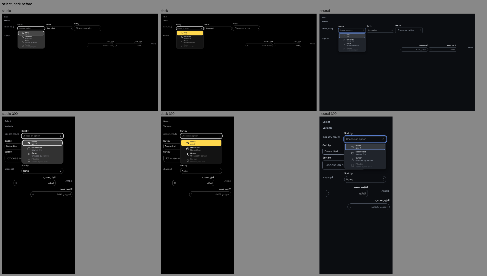 | 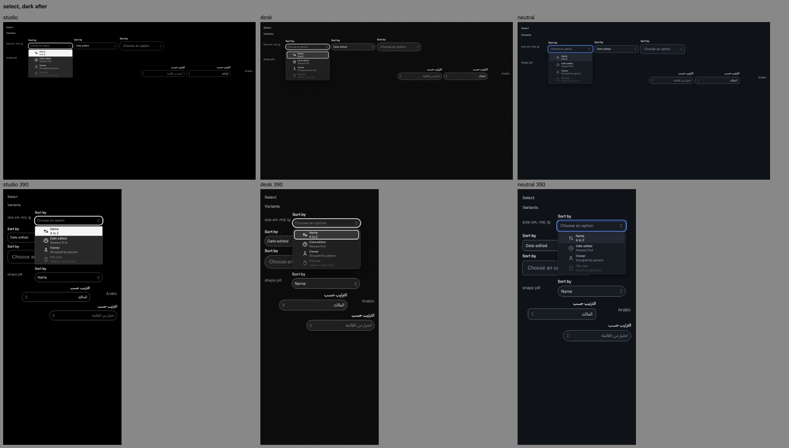 | 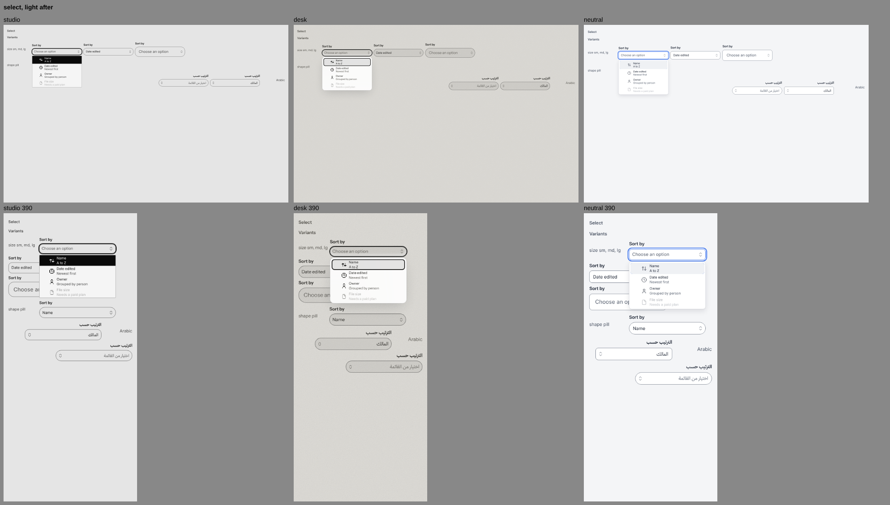 |
| DropdownMenu | 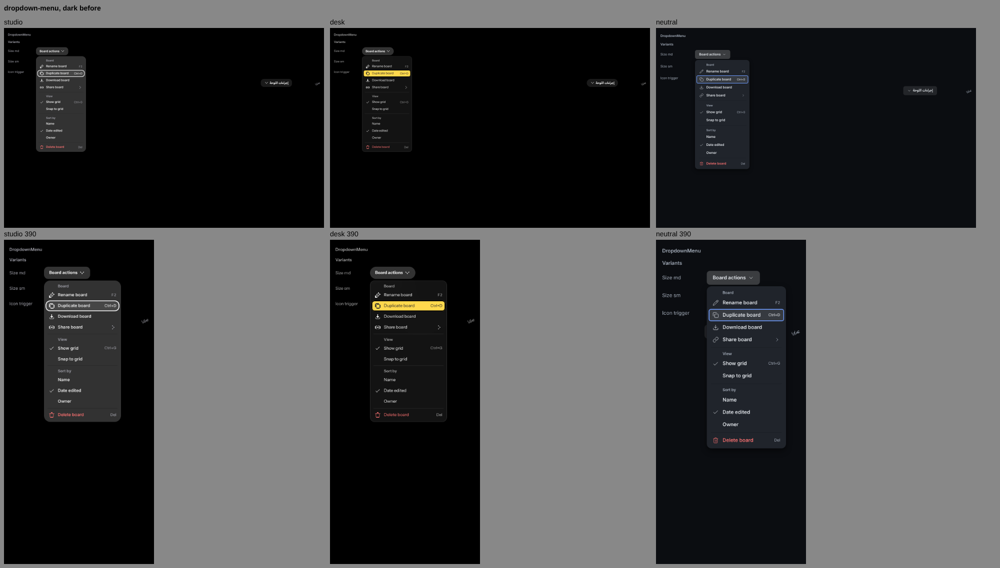 | 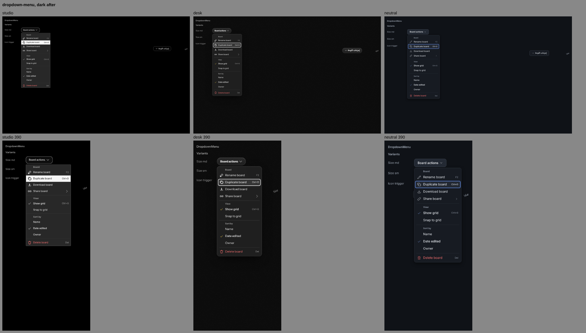 | 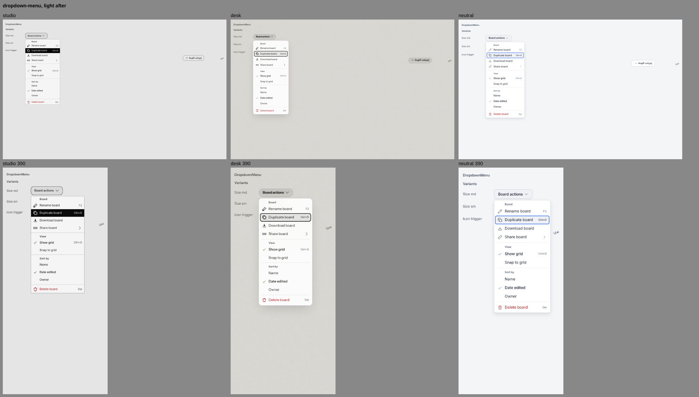 |
| Button | 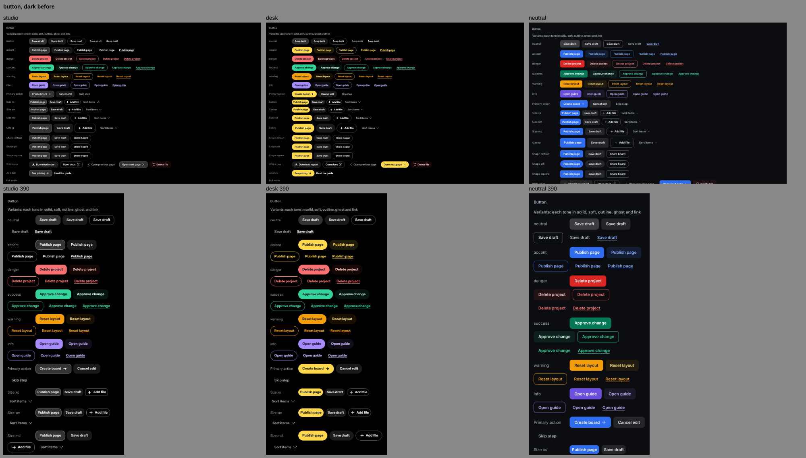 | 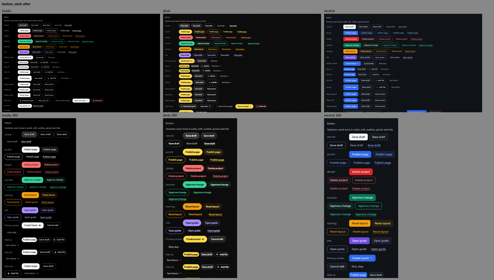 | 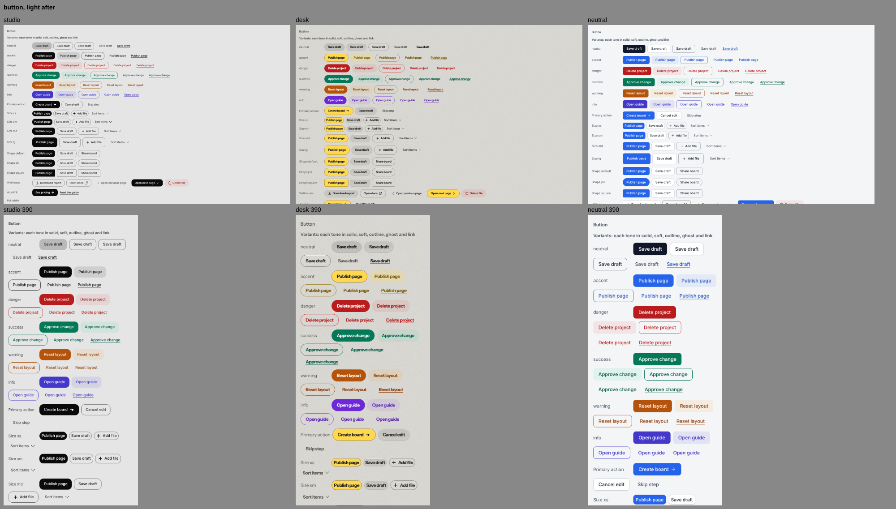 |

## Per dial

| Dial | Studio | Desk | Neutral |
| --- | --- | --- | --- |
| 1 Base | Dark: black body, six flat achromatic steps, text greys made achromatic (bright `#f5f5f5`, muted `#a3a3a3`). Light: body `#e5e5e5`, steps `#ffffff` to `#d4d4d4`, the old blue tint gone | Black desk, with the Window layer's noise tile now on the page itself (a dark tile in light). Off under reduced transparency, more contrast and forced colors | Light: page `#f4f5f7`, white surface. Dark: a near black blue gray (`#0f1217`, surfaces `#171b22` to `#3a424e`), neither Studio's black nor Desk's desk |
| 2 Accent | Neutral primary: `primary.fill` is the bright text (white in dark, black in light). Pastels for identity only | Yellow `#ffd84d` with dark ink on the main dialog action, the toast action, the checked checkbox, the switch and the tab indicator (gold `#987400` in light) | One blue (`#2563eb` light, `#2f6bed` dark) for the filled primary, links, focus and the selected check |
| 3 Depth | Every `elevation.*` is a transparent zero shadow; blur tokens are 0; recipes set every overlay's shadow, blur and scrim filter to none | Glass `#1f1f1f` at 72%, strong glass at 90%. `elevation.window` is four layers: an inset 1px white 16% top highlight, a 1px ring, `0 8 24 -6` and `0 30 80 -20`. Blur 24 and 40px with saturate 1.3 | Small soft two layer shadows (1 to 3px, then 6 to 16px). No glass, no blur, scrim with no blur |
| 4 Separation | 1px gaps between tiles; overlays carry a 1px strong edge; bands sit behind a 1px line; toasts stack 1px apart | Free windows, a glass hairline inside (white 13%) plus the light edge | 1px borders and white space |
| 5 Radius | xs 2, sm 3, field 4, panel 4, card 6, sheet 0, menu rows 0. Controls stay pills | Controls are full pills (`radius.control` is the pill); windows, dialogs, popovers 1rem; menus, lists, toasts 12px; rows, tooltips 8px | Controls and fields 8px; cards, dialogs, toasts 12px; menus 8px; rows 6px |
| 6 Controls | The default button is transparent with a 1px control border. Accent solid is the flat white pill, danger solid the flat red pill with dark text. Medium labels, tabular figures | Neutral buttons are filled glass pills with a top gradient, the inset light edge and a hairline. Fields are filled pills. Roll labels kept | Filled blue primary; the default (soft) button is the white outline secondary with a tiny shadow; ghost is tertiary |
| 7 Density | Compact by its own sizes (see "Changes needed from the lead": compact as the default density is pending) | Roomy: `recipes/Density.css` sets buttons, fields and rows to the control size plus `space.3xs` (36px at default). It follows `[data-density]` | Comfortable (the default), 36px controls, 24px dialog padding |
| 8 Type | Inter Variable, small sizes, medium labels | Instrument Sans. Font sizes s to xl are 13, 14, 15, 17px, one step above Studio. Tracking -0.04em on buttons, tabs, toast, dialog and popover titles (Arabic resets it) | Inter, 14px body, medium control labels, regular rows, semibold titles |
| 9 Icons | Pixel | Pixel | Line, 1.5px |
| 10 Chrome | Rail, sidebars, inspector | Menu bar, dock, windows; the dialog title bar has the title bar material and a hairline | Sidebar, top bar, cards, tables |
| 11 Motion | Spring eases are `steps(2 or 3, jump-end)`; 70 to 220ms; every `distance.*` is 0 and every `scale.*` is 1; no stagger; overlays appear by an opacity step | `scale.dialog-enter` and `menu-enter` are 0.92; dialogs and the palette grow on the soft spring (340ms, 2% overshoot); bouncy is 380ms with a 21.5% overshoot | Critically damped springs: soft 200ms, snappy 158ms, bouncy 200ms, no overshoot; scales 0.98, a 4px rise |
| 12 Focus | 2px achromatic ring, no glow; doubled on a primary fill | 2px achromatic ring, doubled on yellow (dialog footer and toast action included) | 2px blue ring with a 2px gap |

## Per overlay surface

| Surface | Studio | Desk | Neutral |
| --- | --- | --- | --- |
| Dialog | Square panel, title and footer bands one tone step off behind 1px lines, flat scrim with no blur, square ghost close | A glass window with the title bar and its lights, a dim and blurred scrim | White card, 12px, 1px border, 24px padding, no title band, footer on a light band |
| AlertDialog | The icon is a square chip in the title band | No title bar part exists, so the recipe draws a title band and puts the icon in a rounded tile | The icon in a tinted disc in the tone colour |
| Dialog footer | Main action the white pill, secondary a bordered transparent pill, destructive a red fill | Main action the yellow pill, secondary a glass pill, destructive a red pill | Main action filled blue, secondary the white outline, destructive filled red |
| Sheet and Drawer | The same flat material, edge to edge, with no slide (an opacity step) | Glass panels with the light edge and the window shadow; the handle is overlay-40 | White panel, a border on the inner edge, a soft large shadow |
| Toast | A one line strip about 28 to 32px tall: icon, title, description, action and close in one row. Square, hairline, a 2px tone bar. The description ends in an ellipsis at rest and wraps on hover or focus | A small glass card with the soft window shadow and light edge. A 3px tone edge, an icon tile (the tone at 18%), a yellow action pill, a round glass close. Stacked cards overlap | A white card with a soft shadow and no tone bar. The coloured icon sits on a tinted disc; the action is an outline button with blue text |
| Menus and lists (DropdownMenu, ContextMenu, Menubar, Select, MultiSelect, Combobox, Autocomplete, ListBox) | A tight tile list: square edge to edge rows, the lit row inverted, a danger row lit red | A glass panel (40px blur), 12px radius, 6px padding, 8px rows, a soft overlay-10 lit row | A white panel with a border and a soft shadow, 32px rows with 6px corners, lit on a soft gray |
| Selected row | The check plus medium weight | A yellow check (deep gold in light) plus medium weight | A blue check plus medium weight |
| Tooltip | An inverted flat chip, square, no arrow | A glass chip, 8px, with the light edge | A dark slate chip, 6px (surface-5 with a strong edge in dark) |
| Popover and HoverCard | A flat tile, hairline, no shadow, no arrow | Small glass windows, 1rem, light edge | Unchanged: they were already white bordered cards with a soft shadow |
| CommandPalette | Square and flat; dense square rows; inverted lit row | A big glass window placed high, a large search band, a blurred scrim | A white card; the search band's line turns blue on focus; 36px rows |
| Lightbox | A flat stage on the body tone, bordered pill side buttons | A desk dim at 88% with a 40px blur, glass pill toolbar | Ink panel in light, white square controls |

Every style marks a selected row with more than colour alone (WCAG 1.4.1):
a check plus a weight change.

## Proof

- `npm run check`: green before each commit.
- `ds style check studio`, `desk` and `neutral`: pass. 602 contrast pairs
  each; Desk dark has 4 known failures (8 before).
- Contrast gate: no new failure. Four Desk dark entries now pass and were
  removed from `packages/lint/src/contrast-pairs.ts`. All four are
  `text.muted` over `surface-5`, measured on:
  - glass: 5.15
  - glass-tinted: 4.79
  - title bar over glass: 4.68
  - glass-hover over glass: 4.56

  The four `text.subtle` entries remain; fixing them needs nearly opaque glass.
- Contrast pairs only the recipes create, measured by hand, lowest first.
  - Neutral:
    - danger text on the dark footer band: 5.84
    - menu meta on white: 6.07
    - blue check on the light lit row: 6.25
  - Desk: `text.subtle` on glass-strong over surface-5, about 4.6.
  - Studio: `studio.light` `state.danger.fill` failed on the body at 2.98 and
    was moved to `#dc2626`.
- Contract suite (React), green: Button, IconButton, Dialog, AlertDialog,
  Sheet, Drawer, Toast, DropdownMenu, ContextMenu, Menubar, Select,
  MultiSelect, Combobox, Autocomplete, ListBox, CommandPalette, Popover,
  Tooltip, HoverCard, Lightbox, Input, Checkbox, Switch, Tabs, Card,
  TagField, SearchField, PasswordField.
  - The run found one real issue: Studio Lightbox had a black stage with
    light scheme text (1.2:1). Fixed, and Lightbox passes.
  - Two Combobox runs failed on browser resource limits, then passed alone.
- Glass: each glass surface has a solid fallback under
  `@supports not (backdrop-filter)`, and turns solid with no blur under
  `prefers-reduced-transparency`, `prefers-contrast: more` and
  `[data-contrast='more']`. Forced colors keep Canvas, CanvasText and
  Highlight. Studio wraps its colour overrides in `@media (forced-colors: none)`.

## Hooks needed from components

Order 1.23 has, on its work in progress branch, added `--_toaster-gap`,
`--_toast-strip`, `--_dialog-backdrop-blur`, the `--_switch-thumb-*` family
and `--_checkbox-stroke-width`. They are not on this branch yet, and the
vocabulary gate rejects a private name the component does not declare, so
the recipes cannot set them. Once 1.23 merges, a small follow up should set
them:

| Hook | Studio | Desk | Neutral |
| --- | --- | --- | --- |
| `--_toaster-gap` | 1px | A small overlap; replaces the `gap` and margins the recipe sets today | Gap |
| `--_toast-strip` | The one line strip; replaces the grid template the recipe sets directly | Not used | Not used |
| `--_switch-thumb-*` | A solid flat thumb | A glass thumb with the light edge highlight | A white thumb with a soft shadow |
| `--_checkbox-stroke-width` | Thick, pixel-like | Medium | 1.5px |

Still missing after 1.23, as far as its branch shows:

- **AlertDialog**: an optional `titlebar` and `controls` part, as Dialog has
  (`optionalParts['alert-dialog']`), so Desk shows a real title bar with
  lights. Today the band is drawn as a background on the panel.
- **Toast**:
  - `--_toast-edge-width` (Desk wants 3px, Neutral none, Studio 2px). The
    inline start edge is fixed at `border.width.strong` today.
  - `--_toast-icon-bg` and `--_toast-icon-size`, for the icon tile (Desk) and
    disc (Neutral). Today the disc is a spread shadow on the icon part.
  - A layout property for the toast grid template, if `--_toast-strip` does
    not cover it.
- **Dialog**: `--_dialog-header-divider-color`, separate from the footer's
  `--_dialog-divider-color`. Neutral wants a footer line and no header line.
- **Lightbox**: `--_lightbox-scrim-filter`. Desk's backdrop blur is a plain
  declaration in the recipe today.

## Token additions

None. No new semantic name was needed. Every change uses names the contract
already lists.

## What the owner must approve

All three looks stay **proposed**:

1. **Studio**, the flat monochrome look: white primary, no shadow anywhere,
   square overlays, the one line toast strip whose description truncates
   until hover or focus, inverted lit rows, stepped motion.
2. **Desk**, the glass look, dark and light:
   - Glass alpha went from 53% to 72% to fix contrast, so the dial now reads
     `#1f1f1fb8`; PLAN 3.7 still says `#1f1f1f87`.
   - Grain on the page itself.
   - Yellow on more controls: checkbox, switch and tabs.
   - Pill fields.
   - The soft lit row in menus replaces the yellow lit row.
3. **Neutral**:
   - A bluer, lighter dark scheme.
   - The light scrim is now a slate dim.
   - 8px controls.
   - The secondary is the white outline button.
   - Toasts as white cards with icon discs.

The closest pair left is Desk light against Neutral light on the
AlertDialog: both are a white panel with a red main action. Desk is told
apart by its title band, pill buttons, blurred warm scrim and Instrument
Sans. If the owner wants more distance, the next step is warmer glass in
Desk light.

## Changes needed from the lead

1. **Studio default density**: make compact Studio's default
   (`style.json` `defaultDensity: "compact"`, as the dial says). It was
   reverted here because it breaks tests outside this order:
   - `packages/angular/src/theme/theme.spec.ts` ("uses the root defaults
     from style.json")
   - `packages/native/src/components/Button/Button.test.tsx` (expects 32)
   - the `ds --json style list` snapshot in `packages/cli`

   Change the three expectations together with the flip.
2. **Status**: Studio and Desk `style.json` still say `"status": "stable"`.
   The new looks are proposed. Either set `"status": "proposed"` (it changes
   the registry output and the cli snapshot) or record in `STATE.md` that
   the 1.24 look of both is waiting on the owner.
3. **PLAN 3.7**: update Desk's base dial to glass at `#1f1f1fb8`.
4. **`packages/lint/src/contrast-pairs.ts`**: this order removed the four
   Desk dark entries that now pass. The gate fails on stale entries, so the
   file had to change in the same commit. Please review.
5. **After 1.23 merges**: run the follow up in "Hooks needed from components".
6. **Redeploy the docs site** so the owner can see the looks on a phone.

## Sources and limits

- GoBanana could not be fetched here: adding the private repository was
  refused in this session. Studio and Desk build on the values already
  mapped from it in `docs/contracts/token-mapping.md`.
- Figma-Killer-2 was read only for reference, never its
  `vendor/alm-design-system`.
- Arabic was checked through the Arabic cases the variant pages show. Not
  every surface was opened in a full right to left case.
- The Desk toast tone edge has a `:dir(rtl)` rule. The gallery's inline
  toasts force left to right, so it was not seen in a shot.
- Studio and Desk native recipes (`native/`) were not touched. React Native
  looks follow the tokens only.
